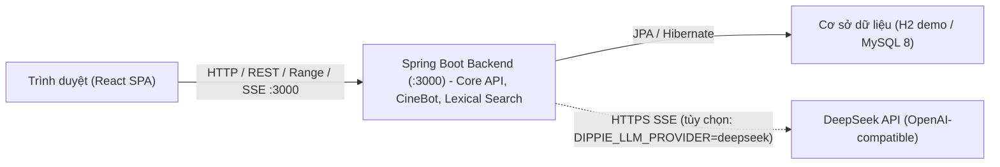

# Dippie Backend — Spring Boot (Java 21)

## 1. Tổng quan

Module `backend/springboot` là backend hợp nhất bằng Java 21 và Spring Boot 3.5 (JPA/Hibernate, Spring Security phi trạng thái dùng JWT), phục vụ toàn bộ core API nghiệp vụ và trợ lý AI runtime trong một tiến trình JVM duy nhất, tuân thủ hợp đồng HTTP trong [CONTRACT.md](CONTRACT.md).

Phân chia thành phần trong hệ thống:

- **Backend Java (`backend/springboot`, cổng `3000`)**: đảm nhiệm toàn bộ nghiệp vụ và trợ lý AI runtime gồm CineBot SSE (`/api/chat`), tìm kiếm/khám phá danh mục cục bộ (`/v1/search`, `/v1/discover`), gợi ý phim theo độ tương đồng và tâm trạng (`/api/recommend`), trạng thái trợ lý (`/api/assistant/status`), xác thực và phân quyền JWT, quản lý phim và danh mục chuẩn hóa, thư viện cá nhân (xem sau, yêu thích, đánh giá), tiến độ xem, cấp vé phát video và truyền phát HTTP Byte Range, nhập/xuất danh mục và quản trị, đồng thời phục vụ giao diện React đã build.
- **Frontend React (`frontend/`)**: sau khi build ra `frontend/dist`, Spring Boot phục vụ trực tiếp các route SPA và tài nguyên tĩnh.
- **Đường ống ML ngoại tuyến (`ai/`)**: xử lý dữ liệu video/phụ đề, trích xuất ngữ cảnh/embedding và tạo gói danh mục ngoại tuyến, tách biệt khỏi đường dẫn phục vụ runtime.

Lý do kiến trúc: đưa cả lõi nghiệp vụ (giao dịch, tính toàn vẹn dữ liệu, khóa đồng thời, truyền phát Byte Range) lẫn trợ lý runtime (chỉ mục từ vựng BM25, phân tích ý định, CineBot SSE với chiến lược câu trả lời mẫu hoặc DeepSeek) về một tiến trình JVM có kiểu tĩnh rõ ràng, giúp vận hành đầy đủ ứng dụng chỉ với Java.

## 2. Sơ đồ kiến trúc



## 3. Cấu trúc package

Mã nguồn tổ chức theo tính năng (package-by-feature) dưới `com.dippie`:

| Package | Trách nhiệm |
| --- | --- |
| `com.dippie` | Điểm khởi chạy ứng dụng (`DippieApplication`). |
| `com.dippie.common.error` | Phân cấp ngoại lệ miền (`DomainException`, `InvalidRequestException`, `UnauthorizedException`, `ForbiddenException`, `NotFoundException`, `ConflictException`, `TooManyRequestsException`, `ServiceUnavailableException`) và bộ xử lý lỗi tập trung `GlobalExceptionHandler`. |
| `com.dippie.common.web` | Khung phản hồi chuẩn `ApiResponse` và cấu hình đồng hồ UTC `ClockConfig`. |
| `com.dippie.common.json` | Tiện ích đọc an toàn dữ liệu JSON lưu trong cột `LONGTEXT` (`JsonText`). |
| `com.dippie.common.text` | Tiện ích chuẩn hóa chuỗi Unicode (`UnicodeText`: case-folding và cắt khoảng trắng tương thích Python). |
| `com.dippie.security` | Cấu hình Spring Security phi trạng thái (`SecurityConfig`), ký và xác thực JWT (`JwtService`, `JwtAuthenticationFilter`), truy xuất người dùng hiện tại (`CurrentViewer`, `SecurityContextCurrentViewer`, `Viewer`, `Role`), giới hạn tần suất đăng nhập (`LoginRateLimiter`), kiểm tra độ mạnh/giới hạn byte mật khẩu (`PasswordPolicy`) và thuộc tính cấu hình (`JwtProperties`, `RateLimitProperties`, `CorsProperties`). |
| `com.dippie.user` | Thực thể tài khoản (`User`, `UserRepository`), luồng đăng nhập/đăng ký/hồ sơ (`AuthService`, `AuthController`), kiểm tra kết nối cơ sở dữ liệu (`HealthController`), khởi tạo quản trị viên (`AdminBootstrap`, `BootstrapAdminProperties`) và tài khoản demo (`DemoAccountSeeder`). |
| `com.dippie.account` | Tự phục vụ tài khoản cho người dùng đã đăng nhập: cập nhật hồ sơ cá nhân và đổi mật khẩu kèm cấp lại JWT mới (`AccountController`, `AccountService`, `UpdateProfileRequest`, `ChangePasswordRequest`). |
| `com.dippie.admin` | Quản trị người dùng có khóa bi quan và bảo vệ quản trị viên hoạt động cuối cùng (`AdminUserController`, `AdminUserService`, `AdminUserPolicy`, `AdminUserView`, `UpdateUserRoleRequest`, `UpdateUserStatusRequest`, `AdminPageResponse`), nhật ký kiểm toán quản trị (`AdminAuditController`, `AdminAuditService`, `AdminAuditEvent`, `AdminAuditEventRepository`, `AdminAuditEventView`, `CatalogImportAuditListener`) và thống kê vận hành (`AdminStatsController`, `AdminStatsService`, `AdminStatsQuery`, `AdminStatsResponse`, `TopWatchedEpisodeView`, `TopRatedMovieView`). |
| `com.dippie.movie` | Truy vấn, lọc, sắp xếp và phân trang phim bằng SQL thông qua JPA `Specification` và Hibernate Criteria (`Movie`, `MovieRepository`, `MovieQueryService`, `MovieController`, `MovieFilter`, `MovieBrowseQuery`, `MovieBrowsePage`, `MovieVisibility`, `MovieView`, `MediaDescriptorView`, `MovieGenre`, `MovieGenreTerm`). |
| `com.dippie.catalog.domain` | Các thực thể JPA danh mục chuẩn hóa (`CatalogRecord`, `CatalogSeries`, `CatalogSeason`, `CatalogEpisode`, `CatalogSegment`, `CatalogScene`, `CatalogMediaAsset`, `CatalogTextTrack`, `CatalogGenre`, `CatalogCharacter`, `CatalogSource`, `CatalogAttributeScale`, `CatalogPackage`, `CatalogSnapshot`, `AuditLog`), bảng liên kết, view, các repository cần thiết và enum miền (`PublicationStatus`, `AccessPolicy`). |
| `com.dippie.catalog.query` | Đọc chi tiết bộ phim/tập phim, kiểm tra quyền hiển thị, tìm kiếm toàn văn và mô hình đọc danh mục bất biến hướng sự kiện (`CatalogController`, `CatalogQueryService`, `CatalogSearchService`, `CatalogVisibility`, `YoutubeSource`, `CatalogReadModel`, `CatalogReadModelCache`, `CatalogReadModelLoader`, `CatalogRecommendationRows`, `SeriesCard`). Khi `CatalogImportService` phát `CatalogImportedEvent` sau commit, `CatalogReadModelCache` tải lại snapshot `CatalogReadModel` mới qua `CatalogReadModelLoader`, còn các luồng đọc đồng thời tiếp tục đọc snapshot bất biến trước đó mà không bị chặn. |
| `com.dippie.catalog.importing` | Kiểm tra hợp lệ gói JSON, tính sai khác, băm nội dung SHA-256, nhập dữ liệu nguyên tử trong một giao dịch, đồng bộ chỉ mục cục bộ, phát sự kiện `CatalogImportedEvent`, quản lý snapshot và xuất danh mục (`AdminCatalogController`, `CatalogImportService`, `CatalogImportTransaction`, `CatalogImportedEvent`, `CatalogPackageValidator`, `CatalogDiff`, `ContentHash`, `CatalogJsonWriter`, `CatalogRecordWriter`, `CatalogRecordMapper`, `CatalogLegacyRows`, `CatalogLinks`, `CatalogExportService`, `CatalogSnapshotService`, `CatalogIndexPublisher`, `IndexSyncOutcome`). |
| `com.dippie.library` | Quản lý danh sách xem sau, yêu thích và đánh giá phim của người dùng (`LibraryController`, `LibraryEntry`, `AbstractLibraryListService`, `WatchlistService`, `WatchlistItem`, `FavoriteService`, `FavoriteItem`, `MovieRatingService`, `MovieRating`). |
| `com.dippie.progress` | Lưu và truy vấn tiến độ xem theo tập phim, khóa lạc quan, chính sách đánh dấu hoàn thành và gợi ý tập xem tiếp theo (`WatchProgressController`, `WatchProgressService`, `WatchProgress`, `WatchProgressCommand`, `WatchDuration`, `CompletionPolicy`, `PlaybackContext`, `PlaybackContextResolver`, `NextEpisodeController`, `NextEpisodeService`, `NextEpisodePolicy`). |
| `com.dippie.media` | Ủy quyền phát video, cấp vé JWT ngắn hạn, định vị tệp đa nguồn an toàn và truyền phát HTTP Byte Range (`PlaybackGrantController`, `PlaybackGrantService`, `PlaybackAccess`, `MediaStreamController`, `MediaStreamService`, `ByteRange`, `MediaFileResolver`, `MediaLocationStrategy`, `DriveCacheLocation`, `DriveMountLocation`, `LocalMediaLocation`, `MediaPathPolicy`, `MediaAsset`). |
| `com.dippie.recommendation` | Gợi ý phim chạy trực tiếp trên backend Java theo chiến lược chấm điểm tương đồng từ cơ sở dữ liệu và chiến lược tìm kiếm theo tâm trạng qua `CatalogSearch` có dự phòng (`RecommendationController`, `RecommendationService`, `RecommendationStrategy`, `AffinityRecommendationStrategy`, `MoodRecommendationStrategy`, `CandidateCatalog`, `ViewerSignals`, `ViewerSignalsRepository`, `RecommendationCandidate`, `RecommendationContext`, `RecommendationRequest`, `RecommendationResult`, `RecommendedItem`). |
| `com.dippie.assistant` | Cấu hình nhà cung cấp LLM (`AssistantProperties` ánh xạ `dippie.assistant.*`), cùng endpoint trạng thái `GET /api/assistant/status` (`AssistantStatusController`). |
| `com.dippie.assistant.search` | Giao diện tìm kiếm danh mục (`CatalogSearch`), triển khai chỉ mục từ vựng BM25 cục bộ trong bộ nhớ (`LocalCatalogSearch`, `LexicalIndex`, `SearchCatalogFlattener`, `LocalIndexPublisher`, `LocalDiscoverController`) và các mô hình yêu cầu/phản hồi (`SearchDocument`, `SearchHit`, `SearchEvidence`, `SearchConstraints`, `DiscoverRequest`, `DiscoverResponse`, `FollowUpSuggestions`). |
| `com.dippie.assistant.chat` | Đường ống CineBot trên Java: phân tích ý định và vá hội thoại (`IntentParser`, `ChatIntent`, `TextFolding`), điều phối truy xuất và luồng SSE (`ChatService`, `LocalChatController`, `ChatRequestValidator`, `ChatConfiguration`, `ChatEvent`, `ChatMetadata`, `ChatDonePayload`, `ChatPipelineStages`, `ChatHistoryMessage`, `ChatCapacityException`, `ChatPayloadTooLargeException`), chiến lược sinh câu trả lời (`AnswerGenerator`, `TemplateAnswerGenerator`, `DeepSeekAnswerGenerator`), câu trả lời mẫu từ danh mục (`CatalogReplies`) và chấm bằng chứng tâm trạng (`MoodEvidence`). |
| `com.dippie.web` | Phục vụ trang SPA từ `frontend/dist`, tài nguyên tĩnh `/assets/**`, `/illustrations/**` và cấu hình đặc tả OpenAPI/Swagger UI (`SpaController`, `WebResourceConfig`, `WebProperties`, `OpenApiConfig`). |

## 4. Quy tắc nghiệp vụ chính

### Lan truyền trạng thái xuất bản (Publication cascade)

- Một bản ghi danh mục chỉ được coi là đã xuất bản khi trường `status` trong `record_json` (chuyển chữ thường) bằng `ready`.
- Quyền hiển thị lan truyền từ trên xuống theo thứ bậc `series -> season -> episode -> segment / scene / asset`: với người dùng không phải `ROLE_ADMIN`, tập phim chỉ hiển thị khi chính tập đó, bộ phim cha và mùa cha (nếu có) đều ở trạng thái `ready`; phân cảnh chỉ hiển thị nếu đã xuất bản và tài nguyên `mediaAssetId` (nếu gắn) nằm trong tập tài nguyên được phép truy cập. Quản trị viên nhìn thấy toàn bộ bản ghi.
- Trên bảng `movies`, bản ghi trùng mã với một `series` hoặc `episode` chưa xuất bản cũng bị ẩn khỏi danh sách và trang chi tiết. Mọi tài nguyên bị ẩn đều trả `404` thay vì `403`.
- **Lớp triển khai**: `PublicationStatus`, `CatalogRecord`, `CatalogScene`, `CatalogVisibility`, `CatalogQueryService`, `CatalogSearchService`, `MovieVisibility`, `MovieQueryService`.

### Chính sách truy cập tài nguyên (Access policy)

- Một `CatalogMediaAsset` chỉ cho phép truy cập khi thỏa đồng thời ba điều kiện: đang bật (`enabled = true`), đã xuất bản (trừ khi người gọi là quản trị viên), và `AccessPolicy` cho phép vai trò hiện tại (`public` cho phép tất cả, `authenticated` yêu cầu đã đăng nhập, `private` chỉ cho phép quản trị viên, giá trị không xác định bị từ chối).
- Khi cấp vé phát hoặc truyền phát tệp, `PlaybackAccess` kết hợp kiểm tra cờ khả dụng/công khai trên `MediaAsset` cùng `CatalogMediaAsset.isAccessibleBy(...)`; nếu bị từ chối đều ném `NotFoundException` (`404`) để không lộ sự tồn tại của tài nguyên.
- **Lớp triển khai**: `AccessPolicy`, `CatalogMediaAsset`, `MediaAsset`, `PlaybackAccess`.

### Tiến độ xem: khóa lạc quan và ngưỡng hoàn thành

- **Khóa lạc quan**: payload gửi lên `expectedVersion` (số nguyên). Giá trị `-1` dùng để tạo mới bản ghi (`optLockVersion = 0`); giá trị `>= 0` dùng để cập nhật và phải khớp `optLockVersion` hiện tại, sau đó tăng lên `expectedVersion + 1` thông qua truy vấn cập nhật có điều kiện phiên bản (`WatchProgressRepository.advanceVersion`). Khi phiên bản sai lệch hoặc có ghi đồng thời gây trùng khóa duy nhất, hệ thống trả `409 Conflict` (`ConflictException`) với thông điệp cố định `"Watch progress changed since it was loaded; refresh and retry."`.
- **Ngữ cảnh phát hợp lệ**: tập phim và bộ/mùa cha phải đã xuất bản; `CatalogMediaAsset` phải có `contentType = video`, `role` khác `dub` và `audio_description`, `coverage_json` có mục `scope = full_episode` khớp `episodeId`, đồng thời `MediaAsset` khả dụng với MIME `video/*`.
- **Thời lượng và vị trí**: thời lượng chuẩn là giá trị dương nhỏ nhất giữa thời lượng của tập và tài nguyên (`WatchDuration.resolve`). `positionMs` phải là số nguyên trong đoạn `[0, 86_400_000]` và không vượt quá thời lượng đã biết.
- **Ngưỡng hoàn thành**: với `durationMs > 0`, tính `fivePercent = max(1, durationMs / 20)`, `nearEnd = min(60_000, fivePercent)` và `threshold = max(durationMs - fivePercent, durationMs - nearEnd)`; tập được xem là hoàn thành khi `positionMs >= threshold`. Danh sách gần đây trả tối đa 30 mục mới nhất.
- **Lớp triển khai**: `WatchProgress`, `WatchProgressCommand`, `WatchDuration`, `CompletionPolicy`, `PlaybackContext`, `PlaybackContextResolver`, `WatchProgressService`, `WatchProgressRepository`, `WatchProgressController`.

### Thư viện cá nhân lũy đẳng (Idempotent library)

- Thêm phim vào `watchlist` hoặc `favorites` kiểm tra sự tồn tại và quyền hiển thị của phim qua `MovieVisibility`. Nếu bản ghi `(user_id, movie_id)` đã có thì trả lại bản ghi hiện tại.
- Để an toàn trước tranh chấp ghi đồng thời trên ràng buộc duy nhất, lệnh lưu chạy trong giao dịch `REQUIRES_NEW`; khi bắt được `DataIntegrityViolationException`, hệ thống đọc lại bản ghi vừa được luồng khác chèn và trả về kết quả thành công.
- Đánh giá phim (`ratings`) kiểm tra điểm nguyên trong khoảng `1..10`; đánh giá lại cập nhật điểm và `updatedAt` trên cùng bản ghi, đồng thời xử lý tranh chấp chèn đồng thời theo cùng nguyên tắc.
- **Lớp triển khai**: `LibraryEntry`, `AbstractLibraryListService`, `WatchlistService`, `WatchlistItem`, `WatchlistItemRepository`, `FavoriteService`, `FavoriteItem`, `FavoriteItemRepository`, `MovieRating`, `MovieRatingService`, `MovieRatingRepository`, `LibraryController`.

### Vé phát video và truyền phát HTTP Byte Range

- `POST /api/media/grant/{assetId}` xác thực quyền qua `PlaybackAccess` rồi phát hành JWT HS256 có thời hạn mặc định 5 phút (`dippie.jwt.playback-grant-validity: PT5M`) gồm các claim `assetId`, `role`, `type=playback_grant`, `purpose=playback`. Token này bị từ chối nếu dùng làm token đăng nhập ở `JwtService.loginSubject`.
- `GET` và `HEAD /api/media/stream/{assetId}` chấp nhận `?grant=` hoặc `?token=` (ngoài phiên đăng nhập Bearer), ủy quyền lại qua `PlaybackAccess`, định vị tệp theo chuỗi chiến lược (`DriveCacheLocation` -> `DriveMountLocation` -> `LocalMediaLocation` với `drive`, hoặc chỉ `LocalMediaLocation` với `local`) và kiểm tra chống path traversal/symlink trong `MediaPathPolicy`.
- `ByteRange.parse` xử lý yêu cầu toàn tệp (`200 OK`) và các dạng `Range`: `bytes=a-b`, `bytes=a-`, `bytes=-n` (`206 Partial Content`, kèm `Accept-Ranges: bytes`, `Content-Range`, đọc theo khối 64 KB qua `FileChannel`). Header sai cú pháp hoặc không thỏa mãn trả `416 Range Not Satisfiable` với `Content-Range: bytes */<totalLength>` và thân rỗng.
- **Lớp triển khai**: `PlaybackGrantController`, `PlaybackGrantService`, `PlaybackGrantResponse`, `PlaybackAccess`, `JwtService`, `MediaStreamController`, `MediaStreamService`, `ResolvedMediaStream`, `ByteRange`, `RangeNotSatisfiableException`, `MediaFileResolver`, `MediaLocationStrategy`, `DriveCacheLocation`, `DriveMountLocation`, `LocalMediaLocation`, `MediaPathPolicy`.

### Nhập danh mục: băm nội dung và xung đột phiên bản

- Gói danh mục được kiểm tra cấu trúc, mã định danh, đường dẫn tệp tương đối, phạm vi `coverage`, quan hệ mùa-bộ và tham chiếu chéo giữa các tập hợp (`CatalogPackageValidator`, `CatalogDiff`).
- `ContentHash` chuẩn hóa JSON qua `CatalogJsonWriter.encode(document, true)` (sắp xếp khóa theo thứ tự mã điểm Unicode, loại bỏ khoảng trắng, giữ nguyên ký tự non-ASCII, định dạng số thực tương thích Python) rồi tính SHA-256 dạng hex chữ thường.
- Quy tắc phát hiện xung đột trong `CatalogDiff`: bản ghi chưa có -> tạo mới; `revision > storedRevision` -> cập nhật; `revision == storedRevision` và trùng `ContentHash` -> không đổi (lũy đẳng); `revision < storedRevision` hoặc cùng `revision` nhưng khác nội dung -> xung đột (`409 Conflict`).
- Quá trình nhập được tuần tự hóa bằng `ReentrantLock` trong `CatalogImportService`. Toàn bộ việc ghi gói, bản ghi danh mục, bảng legacy (`movies`, `media_assets`), bảng liên kết và bản ghi `CatalogSnapshot` (khởi tạo ở trạng thái `PENDING`) diễn ra trong **một giao dịch duy nhất** (`CatalogImportTransaction`) với khóa bi quan `PESSIMISTIC_WRITE`.
- **Đồng bộ chỉ mục và phát sự kiện sau khi nhập**: sau khi giao dịch commit thành công và có thay đổi (`!commit.unchanged()`), `CatalogImportService` gọi `CatalogSnapshotService.synchronize(...)` để xuất dữ liệu qua `CatalogExportService` và cập nhật chỉ mục từ vựng trong bộ nhớ thông qua `CatalogIndexPublisher` (`LocalIndexPublisher` cập nhật trực tiếp `LocalCatalogSearch` và trả `READY`, lưu kết quả qua `CatalogSnapshot.completeIndexSync(...)`), rồi phát sự kiện `CatalogImportedEvent` qua `ApplicationEventPublisher` để `CatalogReadModelCache` làm mới mô hình đọc và `CatalogImportAuditListener` ghi nhật ký kiểm toán (`LocalCatalogSearch.rebuild(...)` bỏ qua ngay khi snapshot đã đồng bộ).
- **Đối soát snapshot khi liệt kê**: `CatalogSnapshotService.list()` (chạy trong khóa `ReentrantLock` của `CatalogImportService`) đọc danh sách snapshot theo `snapshotVersion` giảm dần, chuẩn hóa trạng thái cũ `CACHE_REQUIRED` về `BLOCKED`, và đối soát mọi bản ghi đang chờ chỉ mục (`CatalogSnapshot.isAwaitingIndex()`, gồm `PENDING` và `BUILDING`): snapshot mới nhất được kiểm tra/xuất bản lại qua `CatalogIndexPublisher` và cập nhật qua `completeIndexSync(...)`, còn các snapshot cũ hơn bị thay thế bằng `CatalogSnapshot.supersede(...)` để chuyển sang `SYNC_FAILED`.
- **Lớp triển khai**: `AdminCatalogController`, `CatalogImportService`, `CatalogImportTransaction`, `CatalogImportedEvent`, `CatalogPackageValidator`, `CatalogDiff`, `ContentHash`, `CatalogJsonWriter`, `CatalogRecordWriter`, `CatalogRecordMapper`, `CatalogLegacyRows`, `CatalogLinks`, `CatalogExportService`, `CatalogSnapshotService`, `CatalogSnapshot`, `CatalogPackage`, `CatalogIndexPublisher`, `LocalIndexPublisher`, `IndexSyncOutcome`.

### Công thức chấm điểm gợi ý (Recommendation scoring)

- Endpoint `POST /api/recommend` được triển khai trực tiếp bằng Java (`RecommendationController`, `RecommendationService`, `RecommendationStrategy`, `AffinityRecommendationStrategy`, `MoodRecommendationStrategy`, `CandidateCatalog`, `ViewerSignals`, `ViewerSignalsRepository`, `RecommendedItem`).
- **Lựa chọn chiến lược và cơ chế dự phòng**: khi yêu cầu không truyền `mood` (hoặc chuỗi rỗng), `RecommendationService` chọn `AffinityRecommendationStrategy`. Khi yêu cầu có `mood`, hệ thống dùng `MoodRecommendationStrategy` gọi `CatalogSearch.search(...)` (`LocalCatalogSearch`, với `query = mood`, `limit = 100` và `SearchConstraints` chứa thể loại đầu vào), đối chiếu kết quả theo thứ tự trả về với tập ứng viên hợp lệ chưa xem và ánh xạ sang `RecommendedItem` (kèm `score` và `evidence`). Nếu `!search.isReady()` hoặc gặp `ServiceUnavailableException`, `MoodRecommendationStrategy` tự động dự phòng (fallback) sang `AffinityRecommendationStrategy`.
- **Quy tắc ứng viên hợp lệ (`CandidateCatalog`, `CatalogReadModel`, `RecommendationContext`)**:
  - `CandidateCatalog` đọc danh sách ứng viên dựng sẵn từ `CatalogReadModelCache` (tải qua `CatalogRecommendationRows`). Chỉ xét các tập phim `CatalogEpisode` có `publicationStatus = 'ready'` thỏa mãn `CatalogVisibility.followsPublishedParents` (tập phim, `CatalogSeries` cha và `CatalogSeason` cha nếu có đều đã xuất bản).
  - Tập phải có ít nhất một `CatalogMediaAsset` công khai (`isAccessibleBy(false, false)` — đang bật, đã xuất bản, `accessPolicy = public`), là video tập phim (`isEpisodeVideo()` — `contentType = video`, `role` khác `dub` và `audio_description`) với `coverage_json` chứa mục `scope = full_episode` cho tập đó; hoặc tập chưa có khai báo phạm vi phủ sóng ở bất kỳ `CatalogMediaAsset` nào và không có `primary_media_asset_id` trong `rawJson`.
  - Loại bỏ mọi ứng viên khớp tập `seen` (theo `episode.id` hoặc `seriesId`). Nếu yêu cầu có chỉ định thể loại (`genres`), chỉ giữ các ứng viên giao không rỗng với tập thể loại đó sau chuẩn hóa case-folding Unicode (thể loại của tập kế thừa thể loại của bộ phim cha nếu tập không gắn trực tiếp).
- **Quy tắc tín hiệu `liked` và `seen` (`ViewerSignalsRepository`, `ViewerSignals`)**:
  - `liked` gồm `likedMovieIds` trong yêu cầu; nếu người dùng đã đăng nhập, bổ sung tối đa 100 mục mới nhất cho mỗi nhóm: phim yêu thích (`FavoriteItem`), phim đánh giá cao (`MovieRating` với `rating >= 8`) và tập đã bắt đầu xem (`WatchProgress` với `positionMs > 0`).
  - `seen` gồm toàn bộ `liked` (bao gồm `likedMovieIds` đầu vào) cộng toàn bộ bản ghi `FavoriteItem`, toàn bộ `MovieRating` (mọi mức điểm) và toàn bộ `WatchProgress` (mọi giá trị `positionMs`) của người dùng đó không giới hạn 100 mục.
- Công thức chấm điểm tương đồng trong `AffinityRecommendationStrategy` cho mỗi ứng viên hợp lệ chưa nằm trong `seen` (tập sở thích `preferred`, `themes`, `chars` và `series` được tổng hợp từ thể loại đầu vào cùng các mục trong danh mục khớp `liked`):

```text
score = rating * 0.1
      + 2.0 * |genres(item) ∩ preferred| / max(1, |preferred|)
      + 1.5 * |(themes ∪ keywords)(item) ∩ themes| / max(1, |themes|)
      + 1.2 * |characters(item) ∩ chars| / max(1, |chars|)
      + (0.8 nếu series_id thuộc tập series đã thích, ngược lại 0)
```

- Điểm được làm tròn theo quy tắc `HALF_EVEN` tới 4 chữ số thập phân (`BigDecimal.setScale(4, RoundingMode.HALF_EVEN)`) để khớp hành vi hàm `round(..., 4)` của Python. Danh sách ứng viên sắp xếp giảm dần theo `score`, tiếp đến giảm dần theo `rating` và tăng dần theo `id`, lấy tối đa `limit` mục (mặc định `4`, trong đoạn `1..100`) và đóng gói thành `RecommendedItem`.
- **Lớp triển khai**: `RecommendationController`, `RecommendationService`, `RecommendationStrategy`, `AffinityRecommendationStrategy`, `MoodRecommendationStrategy`, `CandidateCatalog`, `ViewerSignals`, `ViewerSignalsRepository`, `RecommendationCandidate`, `RecommendationContext`, `RecommendationRequest`, `RecommendationResult`, `RecommendedItem`.

### Mô hình đọc danh mục hướng sự kiện (Catalog read model)

- `CatalogReadModel` là snapshot bất biến trong bộ nhớ (mọi tập hợp đều khóa bằng `List.copyOf`/`Set.copyOf`/`Map.copyOf`) gom sẵn danh sách series, tập mã series/tập phim hiển thị, ánh xạ mùa đã xuất bản, tập `hiddenMovieIds`, các dòng tìm kiếm (`CatalogSearchService.SearchRow`), tập ứng viên gợi ý (`CatalogRecommendationRows`) và danh sách tập đã xuất bản (`CatalogReadModel.SeriesEpisode`) theo từng series.
- `CatalogReadModelLoader.load()` chạy trong giao dịch mới chỉ đọc với mức cô lập `REPEATABLE_READ` (`@Transactional(readOnly = true, isolation = Isolation.REPEATABLE_READ, propagation = Propagation.REQUIRES_NEW)`) để dựng snapshot nhất quán.
- `CatalogReadModelCache` giữ tham chiếu hiện hành trong `AtomicReference<CatalogReadModel>`, khởi tạo lười ở lần gọi `current()` đầu tiên và lắng nghe `CatalogImportedEvent` (`@EventListener` trên `refresh`) do `CatalogImportService` phát sau khi `CatalogImportTransaction` commit thành công.
- Trong lúc `refresh` nạp snapshot mới, các luồng đọc đồng thời qua `current()` không bị chặn và tiếp tục đọc snapshot bất biến trước đó cho đến khi `AtomicReference.set(...)` hoán đổi nguyên tử. Nếu `refresh` gặp lỗi runtime, `invalidate()` đặt tham chiếu về `null` để lần đọc kế tiếp tự nạp lại. Mô hình này phục vụ chung cho `CatalogQueryService`, `CatalogSearchService`, `CatalogVisibility`, `CandidateCatalog` và `NextEpisodeService`.
- **Lớp triển khai**: `CatalogReadModel`, `CatalogReadModelCache`, `CatalogReadModelLoader`, `CatalogRecommendationRows`, `CatalogImportedEvent`, `CatalogImportService`.

### Duyệt và lọc phim bằng SQL với JPA Specification

- `MovieRepository` mở rộng `JpaSpecificationExecutor<Movie>` để đếm và lọc phim trực tiếp trong SQL thay vì nạp toàn bộ bảng `movies` lên bộ nhớ.
- `MovieFilter.specification(yearMin, yearMax, hiddenIds)` tạo `Specification<Movie>` kết hợp lọc khoảng năm phát hành (`releaseYear`), loại trừ các mã phim bị ẩn theo `MovieVisibility.hiddenMovieIds()` (lấy từ `CatalogReadModelCache`), tìm chuỗi con không phân biệt hoa thường qua hàm `regexp_like` trên `title`/`description`, và lọc thể loại bằng truy vấn con `EXISTS` trên bảng chuẩn hóa `MovieGenre`/`MovieGenreTerm` (chỉ dự phòng sang cột CSV `genres` khi phim chưa có bản ghi liên kết thể loại).
- `MovieQueryService` thực thi `movieRepository.count(filters)` cùng truy vấn Hibernate Criteria (`orderedMovies(...)`) có `offset`/`fetch` ngay trên SQL trong một `TransactionTemplate` chỉ đọc; khi sắp xếp theo `title` và khóa phụ `id`, biểu thức ép sang `byte[]` để giữ đúng thứ tự mã điểm UTF-8 tương thích bản Python.
- **Lớp triển khai**: `MovieQueryService`, `MovieRepository`, `MovieFilter`, `MovieBrowseQuery`, `MovieBrowsePage`, `MovieVisibility`, `MovieGenre`, `MovieGenreTerm`.

### Phiên bản hóa token và khóa tài khoản (Token versioning)

- Mọi JWT đăng nhập đều mang claim số nguyên không âm `ver` phản ánh `User.tokenVersion` (mặc định `0`), được gắn trong `JwtService.issueLoginToken(...)` và bắt buộc kiểm tra hợp lệ trong `JwtService.parseLoginToken(...)`.
- Khi người dùng đổi mật khẩu (`AccountService.changePassword` -> `User.changePassword`), hoặc quản trị viên đổi vai trò (`User.changeRole`) hay khóa/mở khóa tài khoản (`User.disable`, `User.enable`), `tokenVersion` tăng lên `1`, thu hồi tức thì mọi JWT đã phát hành trước đó. Riêng `POST /api/users/me/password` trả về `AuthResponse` kèm JWT mới đã nâng `ver`.
- `JwtAuthenticationFilter` chỉ thiết lập xác thực khi `user.isEnabled()` là `true` và `user.getTokenVersion() == loginToken.tokenVersion()`; token lệch phiên bản hoặc thuộc tài khoản bị khóa bị bỏ qua (xử lý như ẩn danh, dẫn tới `401` trên endpoint yêu cầu đăng nhập).
- Tại `POST /api/auth/login`, sau khi xác minh đúng mật khẩu, nếu `user.isEnabled()` là `false`, `AuthService.login` ném `ForbiddenException` trả `403 Forbidden` (`"Tài khoản đã bị khóa. Vui lòng liên hệ quản trị viên."`); sai mật khẩu vẫn trả `401` chung để không lộ trạng thái tài khoản.
- **Lớp triển khai**: `User`, `JwtService`, `JwtAuthenticationFilter`, `AuthService`, `AccountService`, `AccountController`.

### Quản trị người dùng: chống tự sửa và bảo vệ quản trị viên cuối cùng

- Các endpoint `/api/admin/users`, `/api/admin/users/{id}/role` và `/api/admin/users/{id}/status` yêu cầu `ROLE_ADMIN` (`CurrentViewer.requireAdmin()`). Danh sách hỗ trợ tìm kiếm theo `username` hoặc `email` và phân trang (`page >= 0`, `1 <= size <= 100`, sắp xếp theo `id` tăng dần).
- **Chống tự thay đổi**: `AdminUserPolicy` kiểm tra `actor.userId()` khác `target.getId()`; nếu quản trị viên tự đổi vai trò hoặc trạng thái của chính mình thì trả `409 Conflict` (`"Không thể tự thay đổi quyền hoặc trạng thái của chính mình."`).
- **Bảo vệ quản trị viên hoạt động cuối cùng bằng khóa bi quan theo thứ tự `id`**: trong giao dịch của `AdminUserService.changeRole` và `changeStatus`, hệ thống gọi `UserRepository.findEnabledByRoleForUpdate(Role.ROLE_ADMIN)` để lấy khóa `PESSIMISTIC_WRITE` trên toàn bộ quản trị viên đang hoạt động theo thứ tự `ORDER BY u.id ASC` (ngăn deadlock khi nhiều quản trị viên thao tác chéo đồng thời), rồi mới khóa dòng mục tiêu qua `UserRepository.findByIdForUpdate(targetUserId)` nếu mục tiêu chưa nằm trong tập đã khóa. Nếu thao tác hạ quyền (`ROLE_ADMIN` -> `ROLE_USER`) hoặc khóa (`enabled = false`) một quản trị viên đang hoạt động mà `enabledAdminCount <= 1`, `AdminUserPolicy` ném `409 Conflict` (`"Hệ thống phải còn ít nhất một quản trị viên đang hoạt động."`).
- **Lớp triển khai**: `AdminUserController`, `AdminUserService`, `AdminUserPolicy`, `AdminUserView`, `UpdateUserRoleRequest`, `UpdateUserStatusRequest`, `AdminPageResponse`, `UserRepository`.

### Nhật ký kiểm toán quản trị (Admin audit trail)

- `AdminAuditService` lưu vết các thao tác quản trị vào bảng `admin_audit_events` (`AdminAuditEvent`, `AdminAuditEventRepository`) gồm `actorUserId`, `actorUsername` (mặc định `"system"` nếu rỗng), `action`, `targetType`, `targetId`, chi tiết JSON (`details_json`) và `createdAt` (UTC).
- Các hành động được ghi nhận gồm:
  - `USER_ROLE_CHANGED`, `USER_DISABLED`, `USER_ENABLED` (đối tượng `USER`): ghi trực tiếp trong giao dịch của `AdminUserService` kèm giá trị trước và sau thay đổi.
  - `CATALOG_IMPORTED` (đối tượng `CATALOG_PACKAGE`): ghi tự động qua `CatalogImportAuditListener` (`@EventListener`) khi nhận `CatalogImportedEvent`, lưu `packageId`, `revision`, `snapshotVersion`, `snapshotId` và `importedAt`.
- `AdminAuditController` cung cấp `GET /api/admin/audit-events` (yêu cầu `ROLE_ADMIN`, phân trang `page >= 0`, `1 <= size <= 100`) sắp xếp theo `createdAt` giảm dần, tiếp đến `id` giảm dần.
- **Lớp triển khai**: `AdminAuditController`, `AdminAuditService`, `AdminAuditEvent`, `AdminAuditEventRepository`, `AdminAuditEventView`, `CatalogImportAuditListener`, `CatalogImportedEvent`.

### Thống kê quản trị (Admin statistics)

- `AdminStatsController` (`GET /api/admin/stats`, yêu cầu `ROLE_ADMIN`) gọi `AdminStatsService` và `AdminStatsQuery` để tổng hợp: `totalUsers`, `activeUsers`, `newUsersLast7Days` (7 ngày gần nhất theo `Clock`), `totalMovies`, `publishedEpisodes` (`publicationStatus = 'ready'`), `totalWatchSessions`, `completedWatchSessions`, `completionRate` (chia và làm tròn `RoundingMode.HALF_UP` tới 4 chữ số thập phân, trả `0.0` khi chưa có phiên xem), `topWatchedEpisodes` (top 10 theo số người xem riêng biệt giảm dần) và `topRatedMovies` (top 10 theo điểm trung bình giảm dần, tiếp đến số lượt đánh giá giảm dần).
- **Tương đương ngưỡng hoàn thành với `CompletionPolicy`**: `AdminStatsQuery.countCompletedWatchSessions()` tính thời lượng hiệu dụng ngay trong JPQL là giá trị dương nhỏ hơn giữa `CatalogEpisode.durationMs` và `CatalogMediaAsset.durationMs` (khớp `WatchDuration.resolve`), sau đó áp dụng đúng ba nhánh tương đương hoàn toàn với `CompletionPolicy`: thời lượng `>= 1_200_000 ms` kiểm tra `positionMs >= duration - 60_000`; từ `20 ms` đến dưới `1_200_000 ms` kiểm tra `positionMs * 20 >= duration * 19`; dưới `20 ms` kiểm tra `positionMs >= duration - 1`.
- **Lớp triển khai**: `AdminStatsController`, `AdminStatsService`, `AdminStatsQuery`, `AdminStatsResponse`, `TopWatchedEpisodeView`, `TopRatedMovieView`, `CompletionPolicy`, `WatchDuration`.

### Tập xem tiếp theo (Next episode)

- `NextEpisodePolicy` chuyển đổi quy tắc của thủ tục lưu trữ `sp_next_episode` sang logic miền Java thuần (chạy đồng nhất trên cả H2 và MySQL), đồng thời dùng ngưỡng hoàn thành chuẩn từ `WatchDuration` và `CompletionPolicy` thay vì chỉ so sánh `position_ms < duration_ms`.
- `NextEpisodeService` yêu cầu người dùng đã đăng nhập (`CurrentViewer.require()`), kiểm tra `seriesId` thuộc `CatalogReadModel.visibleSeriesIds()` (ném `NotFoundException` trả `404` nếu không tồn tại hoặc chưa xuất bản), lấy mọi tập đã xuất bản và hiển thị của bộ phim từ `CatalogReadModel.seriesEpisodes(seriesId)` giống `sp_next_episode` (kể cả tập chỉ phát qua YouTube), chỉ loại các tập mà tệp video duy nhất là `private` đối với người không phải quản trị viên (`memberAccessible`), và truy vấn tiến độ theo bộ phim qua `WatchProgressRepository.findForSeries`.
- Trong `NextEpisodePolicy.pick`, mọi tập đã đạt ngưỡng hoàn thành (`WatchDuration.isCompletedAt`) bị loại bỏ; các tập còn lại có `positionMs > 0` mang lý do `RESUME` (kèm `updatedAt`), còn tập chưa xem hoặc `positionMs == 0` mang lý do `NEXT_UNWATCHED`. Thuật toán ưu tiên các tập `RESUME` theo `updatedAt` giảm dần (xem dở gần nhất), sau đó mới xét các tập `NEXT_UNWATCHED` theo thứ tự `(seasonNumber, episodeNumber, id)` tăng dần (giá trị `null` xếp sau). Khi không còn tập nào để xem tiếp, `NextEpisodeController` (`GET /api/users/next-episode?seriesId=...`) trả `data: null` cùng thông điệp `"Bạn đã xem hết bộ phim này."`.
- **Lớp triển khai**: `NextEpisodeController`, `NextEpisodeService`, `NextEpisodePolicy`, `WatchDuration`, `CompletionPolicy`, `CatalogReadModelCache`, `WatchProgressRepository`.

### Tìm kiếm từ vựng cục bộ và đường ống CineBot

- **Bộ tìm kiếm từ vựng cục bộ (`SearchCatalogFlattener`, `LexicalIndex`, `LocalCatalogSearch`, `LocalIndexPublisher`, `LocalDiscoverController`)**:
  - `SearchCatalogFlattener.flatten(...)` làm phẳng dữ liệu danh mục đã xuất bản thành danh sách `SearchDocument` gồm năm loại: `series`, `episode`, `segment`, `scene` và cửa sổ hội thoại `dialogue` (cửa sổ trượt `45_000 ms`, bước trượt `22_500 ms` sinh từ `text_tracks` đang bật gắn với `media_assets` công khai), bỏ qua bản ghi `draft`/`archived`, kế thừa thể loại từ bộ phim cha và ánh xạ `coverage` sang mốc thời gian theo tập (`SearchDocument.Timecode`).
  - `LexicalIndex` xây dựng chỉ mục đảo BM25 trong bộ nhớ: chuẩn hóa Unicode (case-folding qua `UnicodeText`, gộp song song dạng có dấu và không dấu kể cả `đ -> d`), tách từ kết hợp bigram (trọng số bigram `1.35`), tăng trọng số cho tiêu đề/biệt danh/nhân vật và từ khóa/chủ đề/tình tiết/âm thanh. Khi truy vấn, tách mệnh đề phủ định (`không phải`, `bỏ qua`, `trừ`), nhận diện số mùa/tập (`S01E02`, `mùa ... tập ...`), áp dụng `SearchConstraints` (`include_genres`, `exclude_genres`, `year_min`, `year_max`, `season_number`, `episode_number`, `series_only`), tính điểm hạng RRF (`1.0 / (61 + rank)`), ưu tiên tài liệu có mốc thời gian khi truy vấn hỏi phút/giây, và khử trùng theo `episodeId`.
  - `LocalCatalogSearch` giữ snapshot bất biến trong `AtomicReference`, khởi tạo lười qua `CatalogExportService.exportForIndex()`, cập nhật khi đồng bộ qua `LocalIndexPublisher.publish(...)` hoặc khi nhận `CatalogImportedEvent` (`rebuild`). `LocalDiscoverController` phục vụ `POST /v1/search` và `POST /v1/discover` với `pipelineStages.retrieval = "java-lexical"`, giữ nguyên kiểm tra đầu vào (`DiscoverRequest`, trả `400` khi `query` rỗng và `422` cho lỗi kiểu/trường thừa) và gợi ý câu hỏi tiếp theo (`FollowUpSuggestions`).
  - **Kiểm thử tương đương (`CatalogSearchParityTest`)**: nhập hai gói danh mục đầy đủ `catalog.jadoo.json` và `catalog.larva.json`, chạy và đối chiếu `POST /v1/search` trên **20 truy vấn** cố định (trong fixture `src/test/resources/search-parity/jadoo-larva.json`), đồng thời kiểm tra `series_only`, `/v1/discover`, `GET /api/assistant/status` và lỗi kiểm tra đầu vào.
- **Đường ống CineBot (`IntentParser`, `ChatService`, `AnswerGenerator`, `LocalChatController`)**:
  - **1. Phân tích ý định (`IntentParser`, `ChatIntent`, `TextFolding`)**: nhận diện câu hỏi vá hội thoại (`CONVERSATIONAL_PATCH`) và gộp với lịch sử tin nhắn `user` gần nhất; trích xuất thể loại bao gồm/loại trừ, khoảng năm, số lượng kết quả (`requested_k`), câu hỏi thông tin bộ phim (`series_info`: `episodes`, `seasons`, `characters`, `summary` kèm `series_only=true`), chế độ (`chitchat`, `recommend`, `find_moment`) và ý định gợi ý theo tâm trạng (`moodRecommendation`, `moodTarget`: `cheerful` hoặc `sad`).
  - **2. Truy xuất (`ChatService`, `CatalogSearch`, `MoodEvidence`)**: bỏ qua tìm kiếm với `chitchat`; gọi `CatalogSearch.search(...)` với `semanticQuery` và `SearchConstraints`; riêng `moodRecommendation` mở rộng truy vấn theo tâm trạng (tối đa `100` ứng viên) rồi chấm và xếp hạng lại bằng `MoodEvidence.score(...)` (bỏ qua bản ghi `series` khi người dùng hỏi tập và ưu tiên tập thời lượng không quá 90 phút).
  - **3. Chiến lược sinh câu trả lời (`AnswerGenerator`, `TemplateAnswerGenerator`, `DeepSeekAnswerGenerator`, `CatalogReplies`, `ChatConfiguration`)**: mặc định dùng `TemplateAnswerGenerator` dựng câu trả lời tiếng Việt trực tiếp từ danh mục qua `CatalogReplies` (`conversation = "template"`). Khi cấu hình `dippie.assistant.llm.provider=deepseek` kèm khóa API khác rỗng, `ChatConfiguration` chọn `DeepSeekAnswerGenerator` gửi tối đa 3 trích đoạn bằng chứng sang `/chat/completions` dạng SSE, kiểm tra nghiêm ngặt câu trả lời chỉ dùng từ vựng bám trích đoạn (không tự thêm số/tên tập/mốc giờ hoặc làm lộ khóa API, `conversation = "cloud"`), và tự động dự phòng về văn bản bằng chứng/mẫu (`conversation = "template"`) khi nhà cung cấp lỗi hoặc trả định dạng sai. Các trường hợp `chitchat`, `series_info`, `moodRecommendation` hoặc kết quả rỗng luôn dùng `TemplateAnswerGenerator`.
  - **4. Phát luồng SSE (`LocalChatController`, `ChatRequestValidator`, `ChatEvent`, `ChatMetadata`, `ChatDonePayload`, `ChatPipelineStages`)**: `POST /api/chat` giới hạn payload `1 MB` (`ChatPayloadTooLargeException`), kiểm tra đầu vào qua `ChatRequestValidator`, trả `503` với `{"detail": "Chưa có snapshot catalog được chấp nhận."}` nếu chỉ mục chưa sẵn sàng, và phát luồng `text/event-stream; charset=utf-8` theo thứ tự sự kiện `metadata` -> nhiều `token` -> `done` (hoặc `error` nếu truy xuất thất bại vì quá tải/chưa sẵn sàng).
  - **Trạng thái trợ lý (`AssistantStatusController`, `AssistantProperties`)**: `GET /api/assistant/status` trả `ApiResponse` gồm `searchReady`, `documents` và `llmProvider`.
- **Lớp triển khai**: `AssistantProperties`, `AssistantStatusController`, `CatalogSearch`, `LocalCatalogSearch`, `LexicalIndex`, `SearchCatalogFlattener`, `LocalDiscoverController`, `LocalIndexPublisher`, `DiscoverRequest`, `DiscoverResponse`, `SearchDocument`, `SearchHit`, `SearchEvidence`, `SearchConstraints`, `FollowUpSuggestions`, `IntentParser`, `ChatIntent`, `TextFolding`, `ChatService`, `AnswerGenerator`, `TemplateAnswerGenerator`, `DeepSeekAnswerGenerator`, `LocalChatController`, `ChatRequestValidator`, `ChatConfiguration`, `CatalogReplies`, `MoodEvidence`, `ChatEvent`, `ChatMetadata`, `ChatDonePayload`, `ChatPipelineStages`.

## 5. Design pattern và nguyên tắc OOP

### Các Design pattern áp dụng

| Pattern | Lớp triển khai | Lý do áp dụng |
| --- | --- | --- |
| Strategy | `MediaLocationStrategy`, `DriveCacheLocation`, `DriveMountLocation`, `LocalMediaLocation`, `MediaFileResolver`; `CatalogIndexPublisher`, `LocalIndexPublisher` | Tách từng cách định vị tệp video (cache Drive, ổ gắn Drive, thư mục cục bộ) và cô lập cơ chế xuất bản chỉ mục sau nhập danh mục khỏi `CatalogSnapshotService` giúp dễ kiểm thử độc lập. |
| Strategy | `CatalogSearch`, `LocalCatalogSearch` | Tách hợp đồng tìm kiếm danh mục khỏi `ChatService`, `MoodRecommendationStrategy` và `AssistantStatusController`, cho phép thay thế/giả lập khi kiểm thử mà không phụ thuộc chỉ mục BM25 cụ thể. |
| Strategy | `AnswerGenerator`, `TemplateAnswerGenerator`, `DeepSeekAnswerGenerator`, `ChatConfiguration`, `ChatService` | Tách chiến lược dựng câu trả lời CineBot (trả lời mẫu cục bộ `TemplateAnswerGenerator` mặc định so với tóm tắt bám bằng chứng qua DeepSeek `DeepSeekAnswerGenerator` khi cấu hình `DIPPIE_LLM_PROVIDER=deepseek` và khóa API), giữ nguyên đường ống `ChatService` và giao thức SSE. |
| Strategy | `RecommendationStrategy`, `AffinityRecommendationStrategy`, `MoodRecommendationStrategy`, `RecommendationService` | Tách chiến lược gợi ý theo độ tương đồng từ cơ sở dữ liệu và chiến lược tìm kiếm theo tâm trạng qua `CatalogSearch` (kèm cơ chế dự phòng sang chấm điểm tương đồng khi chỉ mục chưa sẵn sàng hoặc gặp lỗi) thành các cài đặt hoán đổi được. |
| Template Method | `AbstractLibraryListService`, `WatchlistService`, `FavoriteService` (cùng thực thể cơ sở `LibraryEntry`) | Dùng chung toàn bộ khung nghiệp vụ của danh sách cá nhân (xác thực người gọi, kiểm tra hiển thị phim, thêm lũy đẳng và khôi phục khi trùng khóa duy nhất trong giao dịch `REQUIRES_NEW`), lớp con chỉ cài đặt thao tác lưu trữ đặc thù. |
| Value Object | `ByteRange`, `ContentHash`, `WatchDuration`, `WatchProgressCommand`, `PasswordPolicy`, `PublicationStatus`, `AccessPolicy`, `Viewer`, `MovieBrowseQuery`, `YoutubeSource`, `ChatIntent`, `SearchConstraints` | Biểu diễn khái niệm miền bất biến bằng Java `record` và `enum`, tự kiểm tra hợp lệ khi khởi tạo và đóng gói trực tiếp các phép tính gắn với dữ liệu đó. |
| Repository | `UserRepository`, `MovieRepository` (mở rộng `JpaSpecificationExecutor`), `WatchProgressRepository`, `MediaAssetRepository`, `WatchlistItemRepository`, `FavoriteItemRepository`, `MovieRatingRepository`, `AdminAuditEventRepository`, `AdminStatsQuery`, các `Catalog*Repository`, cùng `CatalogDiff`, `CatalogRecordWriter`, `CatalogImportTransaction` | Cô lập tầng truy cập dữ liệu JPA/Hibernate (tương thích cả H2 và MySQL 8) khỏi logic điều phối ứng dụng và quy tắc miền. |
| Domain Event / Observer | `CatalogImportedEvent` (phát bởi `CatalogImportService` qua `ApplicationEventPublisher`) với các `@EventListener`: `CatalogReadModelCache`, `CatalogImportAuditListener`, `LocalCatalogSearch`; `AdminBootstrap`, `DemoAccountSeeder` (`ApplicationRunner`); `CatalogRecord`, `CatalogPackage`, `CatalogSnapshot`, `MediaAsset` (`@PrePersist`/`@PreUpdate`) | Sau khi giao dịch `CatalogImportTransaction` commit thành công và đồng bộ chỉ mục cục bộ qua `CatalogSnapshotService.synchronize`, `CatalogImportService` phát `CatalogImportedEvent` để tách rời các phản ứng độc lập: `CatalogReadModelCache` tải lại snapshot mô hình đọc bất biến và `CatalogImportAuditListener` ghi sự kiện `CATALOG_IMPORTED` qua `AdminAuditService`. |

### Đóng gói và nguyên tắc SOLID

- **Đóng gói (Encapsulation)**: không dùng Lombok; các thực thể JPA không mở setter công khai tùy ý cho các thuộc tính bất biến mà chỉ cung cấp constructor rõ ràng và phương thức miền thể hiện ý định như `WatchProgress.start(...)`, `WatchProgress.advance(...)`, `MovieRating.updateRating(...)`, `User.changePassword(...)`, `User.updateProfile(...)`, `User.changeRole(...)`, `User.disable(...)`, `User.enable(...)`, `CatalogMediaAsset.isAccessibleBy(...)`, `CatalogPackage.applyImport(...)`, `CatalogSnapshot.completeIndexSync(...)`, `CatalogSnapshot.supersede(...)`. DTO phản hồi và yêu cầu đều là Java `record` bất biến.
- **Single Responsibility (SRP)**: tách rành mạch Controller (ánh xạ HTTP), Service (điều phối giao dịch và quy trình), đối tượng chính sách/miền (`CompletionPolicy`, `NextEpisodePolicy`, `AdminUserPolicy`, `PlaybackAccess`, `MediaPathPolicy`, `CatalogPackageValidator`, `MovieFilter`, `IntentParser`, `LexicalIndex`, `MoodEvidence`, `CatalogReplies`) và Repository.
- **Open/Closed (OCP)**: thêm nguồn lưu trữ media chỉ cần cài đặt mới cho `MediaLocationStrategy`; thêm thuật toán gợi ý cài đặt `RecommendationStrategy`; thêm nhà cung cấp sinh câu trả lời CineBot cài đặt `AnswerGenerator`; mở rộng tìm kiếm hoặc xuất bản chỉ mục qua `CatalogSearch` và `CatalogIndexPublisher`.
- **Liskov Substitution (LSP)**: `WatchlistService` và `FavoriteService` thay thế hoàn toàn hợp đồng của `AbstractLibraryListService`; `TemplateAnswerGenerator` và `DeepSeekAnswerGenerator` thay thế nhau sau `AnswerGenerator`; mọi ngoại lệ kế thừa `DomainException` đều được `GlobalExceptionHandler` xử lý đồng nhất thành `ApiResponse`.
- **Interface Segregation (ISP)**: các giao diện được giữ nhỏ và chuyên biệt (`CurrentViewer`, `MediaLocationStrategy`, `CatalogIndexPublisher`, `RecommendationStrategy`, `CatalogSearch`, `AnswerGenerator`), kết hợp các projection hẹp trên repository để chỉ đọc đúng cột cần thiết.
- **Dependency Inversion (DIP)**: toàn bộ bean sử dụng constructor injection với trường `final`, phụ thuộc vào abstraction (`CurrentViewer`, `PasswordEncoder`, `Clock`, `CatalogIndexPublisher`, `MediaLocationStrategy`, `RecommendationStrategy`, `CatalogSearch`, `AnswerGenerator`) giúp kiểm thử đơn vị độc lập với thời gian hệ thống và hạ tầng ngoài.

## 6. Cách chạy

### Yêu cầu hệ thống

- **JDK 21** trở lên.
- **Node.js 22** trở lên (cần để build giao diện `frontend/dist` lần đầu hoặc khi chỉnh sửa frontend).

### Chạy hồ sơ `demo` (mặc định, dùng H2)

Từ thư mục gốc của kho mã nguồn (Windows PowerShell):

```powershell
.\start-java.ps1
```

Script tự kiểm tra và build `frontend/dist` nếu chưa tồn tại, sau đó khởi động Spring Boot với hồ sơ `demo` tại `http://localhost:3000`. Chỉ với lệnh này, hệ thống đã phục vụ đầy đủ CineBot (`/api/chat`), tìm kiếm/khám phá (`/v1/search`, `/v1/discover`), gợi ý theo tâm trạng và `/api/assistant/status`. Nếu giao diện đã được build sẵn, có thể chạy trực tiếp từ `backend/springboot`:

```powershell
.\mvnw.cmd spring-boot:run
```

(Trên Linux/macOS dùng `./mvnw spring-boot:run`.)

Đặc điểm hồ sơ `demo`:

- Cơ sở dữ liệu H2 lưu tệp tại `target/dippie-java/dippie` (có thể đổi bằng `DIPPIE_DATA_DIR`), `spring.jpa.hibernate.ddl-auto=update`.
- Nếu bỏ trống `APP_JWT_SECRET`, `JwtService` tự sinh khóa tạm 32 byte khi khởi động.
- `DemoAccountSeeder` tự tạo hai tài khoản mẫu (chỉ dùng cho môi trường thử nghiệm):
  - Quản trị viên: `admin` / `password123` (`ROLE_ADMIN`)
  - Người dùng thường: `user` / `password123` (`ROLE_USER`)
- Nạp gói danh mục qua màn hình quản trị để thêm phim và tài nguyên media vào cơ sở dữ liệu mới.
- Sau khi khởi động, tài liệu tương tác Swagger UI sẵn sàng tại `http://localhost:3000/swagger-ui.html` (chuyển hướng sang `/swagger-ui/index.html`) và đặc tả OpenAPI JSON tại `http://localhost:3000/v3/api-docs` (cấu hình trong `OpenApiConfig`).

### Cấu hình DeepSeek cho CineBot và kiểm tra trạng thái trợ lý

Trong `src/main/resources/application.yml`, nhóm thuộc tính `dippie.assistant.*` (ánh xạ bởi `AssistantProperties`) điều khiển nhà cung cấp LLM:

- `DIPPIE_LLM_PROVIDER` (`dippie.assistant.llm.provider`, mặc định `template`): đặt `deepseek` để bật `DeepSeekAnswerGenerator` (tóm tắt câu trả lời bám bằng chứng qua API tương thích OpenAI); nếu thiếu khóa API, hệ thống tự dùng `TemplateAnswerGenerator`.
- `LLM_API_KEY` hoặc `DEEPSEEK_API_KEY` (`dippie.assistant.llm.api-key`): khóa xác thực Bearer gửi tới API LLM (ưu tiên `LLM_API_KEY`, rơi về `DEEPSEEK_API_KEY`).
- `LLM_BASE_URL` / `DEEPSEEK_BASE_URL` (mặc định `https://api.deepseek.com`), `LLM_MODEL` / `DEEPSEEK_MODEL` (mặc định `deepseek-chat`).

Ví dụ bật DeepSeek trên PowerShell:

```powershell
$env:DIPPIE_LLM_PROVIDER = "deepseek"
$env:DEEPSEEK_API_KEY = "<khoa-api-deepseek>"   # hoặc $env:LLM_API_KEY
.\start-java.ps1
```

Kiểm tra nhanh trạng thái trợ lý tại `GET http://localhost:3000/api/assistant/status` (`AssistantStatusController`), trả về `ApiResponse` gồm `searchReady`, `documents` và `llmProvider`.

### Chạy hồ sơ `mysql` (MySQL 8)

Hồ sơ `mysql` bật `spring.jpa.hibernate.ddl-auto=validate` và tắt seed dữ liệu demo (`dippie.seed-demo-data=false`), do đó với cơ sở dữ liệu mới cần tạo lược đồ MySQL trước bằng tệp `database/schema/01_init.sql`, sau đó nạp `database/objects/views.sql`, `functions.sql`, `procedures.sql`, `triggers.sql` (xem `database/README.md`). Với cơ sở dữ liệu MySQL đã tồn tại từ trước, cần chạy bổ sung migration `database/migrations/11_account_controls_and_admin_audit.sql` (lũy đẳng: thêm cột `users.enabled`, `users.token_version` và tạo bảng `admin_audit_events`). Toàn bộ entity đã được Hibernate đối chiếu thành công với lược đồ này trên MySQL 8.0.46; các luồng nhập danh mục, thư viện cá nhân, tiến độ xem (kèm trigger thời lượng) và gợi ý đã chạy thử trên MySQL.

Đặt các biến môi trường cần thiết trước khi chạy:

```powershell
$env:MYSQL_HOST = "localhost"
$env:MYSQL_PORT = "3306"
$env:MYSQL_DB = "movie_rcm_db"
$env:MYSQL_USER = "dippie_app"
$env:MYSQL_PASSWORD = "<mat-khau-mysql>"

# Bắt buộc ngoài hồ sơ demo/test: chuỗi Base64 giải mã tối thiểu 32 byte
$env:APP_JWT_SECRET = "<base64-32-bytes-tro-len>"

# Tùy chọn để AdminBootstrap tạo tài khoản quản trị đầu tiên (mật khẩu 16 ký tự..72 byte UTF-8)
$env:APP_BOOTSTRAP_ADMIN_USERNAME = "dippie-admin"
$env:APP_BOOTSTRAP_ADMIN_EMAIL = "admin@example.com"
$env:APP_BOOTSTRAP_ADMIN_PASSWORD = "<mat-khau-quan-tri-tu-16-ky-tu>"

.\start-java.ps1 -Profile mysql
```

Các biến môi trường tùy chọn khác được khai báo trong `src/main/resources/application.yml`: `PORT` (mặc định `3000`), `APP_JWT_EXPIRATION` (mặc định `PT24H`), `APP_MEDIA_ROOT`, `APP_MEDIA_CACHE_ROOT`, `APP_MEDIA_DRIVE_MOUNT`, `DIPPIE_LLM_PROVIDER` (mặc định `template`), `LLM_BASE_URL`/`DEEPSEEK_BASE_URL`, `LLM_MODEL`/`DEEPSEEK_MODEL`, `LLM_API_KEY`/`DEEPSEEK_API_KEY`, `DIPPIE_WEB_DIST` (mặc định `../../frontend/dist`), `CORS_ALLOWED_ORIGINS`.

Để làm lại dữ liệu demo từ đầu, dừng ứng dụng rồi xóa thư mục `target/dippie-java`.

### Nhập danh mục mẫu từ `data/catalog-by-series`

1. Đăng nhập tài khoản quản trị (`admin` / `password123` ở hồ sơ `demo`, hoặc tài khoản bootstrap ở hồ sơ `mysql`).
2. Mở trang quản trị nhập dữ liệu tại `http://localhost:3000/admin/import`.
3. Chọn lần lượt các tệp trong thư mục `data/catalog-by-series/`, bấm kiểm tra hợp lệ và nhập vào hệ thống:
   - `catalog.jadoo.json`
   - `catalog.larva.json`
   - `catalog.ori.json`
   - `catalog.doraemon.json`
   - `catalog.trang_quynh.json`
   - `catalog.peppa_pig.json`

## 7. Kiểm thử

Chạy toàn bộ bộ kiểm thử từ thư mục `backend/springboot`:

```bash
./mvnw test
```

Trên Windows PowerShell dùng `.\mvnw.cmd test` (có thể thêm `-o -B` khi chạy offline/CI). Kiểm thử chạy trên hồ sơ `test` với H2 in-memory, bao gồm unit test cho quy tắc miền, kiểm thử đối chiếu tìm kiếm (`CatalogSearchParityTest`: 20 truy vấn trên Jadoo và Larva) và integration test bằng `@SpringBootTest` + `@AutoConfigureMockMvc`.

Thống kê số lượng lớp kiểm thử theo package (tổng cộng 51 lớp):

| Package | Số lớp kiểm thử |
| --- | ---: |
| `com.dippie.account` | 1 |
| `com.dippie.admin` | 3 |
| `com.dippie.assistant.chat` | 8 |
| `com.dippie.assistant.search` | 2 |
| `com.dippie.catalog.domain` | 5 |
| `com.dippie.catalog.importing` | 5 |
| `com.dippie.catalog.query` | 2 |
| `com.dippie.library` | 1 |
| `com.dippie.media` | 4 |
| `com.dippie.movie` | 4 |
| `com.dippie.progress` | 5 |
| `com.dippie.recommendation` | 2 |
| `com.dippie.security` | 5 |
| `com.dippie.user` | 2 |
| `com.dippie.web` | 2 |
| **Tổng cộng** | **51** |

## 8. Quy ước phản hồi và kiểm tra dữ liệu

1. **Lỗi kiểm tra dữ liệu trả `400` theo envelope**: `GlobalExceptionHandler` xử lý tập trung các lỗi dữ liệu đầu vào và trả HTTP `400 Bad Request` trong khung `ApiResponse` (`success: false`, `message`, `data: null`, `timestamp`). Ngoại lệ theo đúng hợp đồng là `POST /api/admin/catalog/validate` (trả JSON thô `CatalogValidation` mã `400`) và các endpoint `POST /api/chat`, `POST /v1/search`, `POST /v1/discover` (trả mã `400`/`422` và thân `{"detail": ...}`).
2. **Kiểm tra xác thực và phân quyền trước khi kiểm tra payload**: các endpoint người dùng (`WatchProgressService`, `AbstractLibraryListService`, `MovieRatingService`, `AuthService`) gọi `CurrentViewer.require()` (`401`) và các endpoint quản trị (`AdminCatalogController`) gọi `CurrentViewer.requireAdmin()` (`403`) trước khi kiểm tra hợp lệ các trường nghiệp vụ (và tại `AdminCatalogController`, trước cả bước đọc thân JSON từ `HttpServletRequest`). Nhờ đó, yêu cầu chưa đăng nhập hoặc thiếu quyền không nhận nhầm lỗi kiểm tra dữ liệu `400`/`422`.
3. **Tiến độ xem bắt buộc số nguyên JSON nghiêm ngặt**: `WatchProgressCommand.from` kiểm tra chặt `isIntegralNumber() && canConvertToLong()` cho cả `expectedVersion` và `positionMs`, từ chối các giá trị boolean (`true`/`false`), chuỗi số (`"1"`, `"100"`) và số thực kể cả dạng `.0` (`1.0`, `12.5`) với mã `400`, thay vì ép kiểu ngầm.
