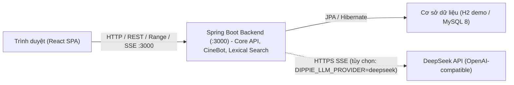

# Backend Dippie (Spring Boot, Java 21)

## 1. Tổng quan

`backend/springboot` là backend hợp nhất bằng Java 21 và Spring Boot 3.5 (JPA/Hibernate, Spring Security phi trạng thái dùng JWT). Toàn bộ API nghiệp vụ và trợ lý AI runtime chạy chung trong một tiến trình JVM, giữ nguyên hợp đồng HTTP trong [CONTRACT.md](CONTRACT.md).

Các phần chính của hệ thống:

- Backend Java (`backend/springboot`, cổng `3000`): xử lý API nghiệp vụ và trợ lý AI runtime, gồm CineBot SSE (`/api/chat`), tìm kiếm/khám phá danh mục cục bộ (`/v1/search`, `/v1/discover`), gợi ý phim theo độ tương đồng và tâm trạng (`/api/recommend`), trạng thái trợ lý (`/api/assistant/status`), xác thực và phân quyền JWT, quản lý phim và danh mục chuẩn hóa, thư viện cá nhân (xem sau, yêu thích, đánh giá), tiến độ xem, cấp vé phát video và truyền phát HTTP Byte Range, nhập/xuất danh mục, quản trị, đồng thời phục vụ bản build của giao diện React.
- Frontend React (`frontend/`): sau khi build ra `frontend/dist`, Spring Boot phục vụ thẳng các route SPA và tài nguyên tĩnh.
- Đường ống ML ngoại tuyến (`ai/`): xử lý video/phụ đề, trích ngữ cảnh/embedding và sinh gói danh mục ngoại tuyến, tách riêng khỏi luồng phục vụ runtime.

Mình gom cả lõi nghiệp vụ (giao dịch, ràng buộc dữ liệu, khóa đồng thời, truyền phát Byte Range) lẫn trợ lý runtime (chỉ mục BM25, phân tích ý định, CineBot SSE dùng câu trả lời mẫu hoặc DeepSeek) về một tiến trình JVM để chỉ cần Java là chạy được trọn bộ ứng dụng.

## 2. Sơ đồ kiến trúc



## 3. Cấu trúc package

Mã nguồn chia theo tính năng (package-by-feature) dưới `com.dippie`:

| Package | Trách nhiệm |
| --- | --- |
| `com.dippie` | Điểm khởi chạy ứng dụng (`DippieApplication`). |
| `com.dippie.common.error` | Phân cấp ngoại lệ miền (`DomainException`, `InvalidRequestException`, `UnauthorizedException`, `ForbiddenException`, `NotFoundException`, `ConflictException`, `TooManyRequestsException`, `ServiceUnavailableException`) và bộ xử lý lỗi tập trung `GlobalExceptionHandler`. |
| `com.dippie.common.web` | Khung phản hồi chuẩn `ApiResponse` và cấu hình đồng hồ UTC `ClockConfig`. |
| `com.dippie.common.json` | Tiện ích đọc an toàn dữ liệu JSON lưu trong cột `LONGTEXT` (`JsonText`). |
| `com.dippie.common.text` | Tiện ích chuẩn hóa chuỗi Unicode (`UnicodeText`: case-folding và cắt khoảng trắng tương thích Python). |
| `com.dippie.security` | Cấu hình Spring Security phi trạng thái (`SecurityConfig`), ký và xác thực JWT (`JwtService`, `JwtAuthenticationFilter`), lấy người dùng hiện tại (`CurrentViewer`, `SecurityContextCurrentViewer`, `Viewer`, `Role`), giới hạn tần suất đăng nhập (`LoginRateLimiter`), kiểm tra độ mạnh/giới hạn byte mật khẩu (`PasswordPolicy`) và thuộc tính cấu hình (`JwtProperties`, `RateLimitProperties`, `CorsProperties`). |
| `com.dippie.user` | Thực thể tài khoản (`User`, `UserRepository`), luồng đăng nhập/đăng ký/hồ sơ (`AuthService`, `AuthController`), kiểm tra kết nối cơ sở dữ liệu (`HealthController`), khởi tạo quản trị viên (`AdminBootstrap`, `BootstrapAdminProperties`) và tài khoản demo (`DemoAccountSeeder`). |
| `com.dippie.account` | Tự sửa thông tin tài khoản cho người đã đăng nhập: cập nhật hồ sơ và đổi mật khẩu kèm cấp JWT mới (`AccountController`, `AccountService`, `UpdateProfileRequest`, `ChangePasswordRequest`). |
| `com.dippie.admin` | Quản trị người dùng có khóa bi quan và giữ lại ít nhất một quản trị viên đang hoạt động (`AdminUserController`, `AdminUserService`, `AdminUserPolicy`, `AdminUserView`, `UpdateUserRoleRequest`, `UpdateUserStatusRequest`, `AdminPageResponse`), nhật ký kiểm toán quản trị (`AdminAuditController`, `AdminAuditService`, `AdminAuditEvent`, `AdminAuditEventRepository`, `AdminAuditEventView`, `CatalogImportAuditListener`) và thống kê vận hành (`AdminStatsController`, `AdminStatsService`, `AdminStatsQuery`, `AdminStatsResponse`, `TopWatchedEpisodeView`, `TopRatedMovieView`). |
| `com.dippie.movie` | Truy vấn, lọc, sắp xếp và phân trang phim bằng SQL qua JPA `Specification` và Hibernate Criteria (`Movie`, `MovieRepository`, `MovieQueryService`, `MovieController`, `MovieFilter`, `MovieBrowseQuery`, `MovieBrowsePage`, `MovieVisibility`, `MovieView`, `MediaDescriptorView`, `MovieGenre`, `MovieGenreTerm`). |
| `com.dippie.catalog.domain` | Các thực thể JPA danh mục chuẩn hóa (`CatalogRecord`, `CatalogSeries`, `CatalogSeason`, `CatalogEpisode`, `CatalogSegment`, `CatalogScene`, `CatalogMediaAsset`, `CatalogTextTrack`, `CatalogGenre`, `CatalogCharacter`, `CatalogSource`, `CatalogAttributeScale`, `CatalogPackage`, `CatalogSnapshot`, `AuditLog`), bảng liên kết, view, repository và enum miền (`PublicationStatus`, `AccessPolicy`). |
| `com.dippie.catalog.query` | Đọc chi tiết bộ/tập phim, kiểm tra quyền hiển thị, tìm kiếm toàn văn và mô hình đọc danh mục bất biến theo sự kiện (`CatalogController`, `CatalogQueryService`, `CatalogSearchService`, `CatalogVisibility`, `YoutubeSource`, `CatalogReadModel`, `CatalogReadModelCache`, `CatalogReadModelLoader`, `CatalogRecommendationRows`, `SeriesCard`). Khi `CatalogImportService` phát `CatalogImportedEvent` sau commit, `CatalogReadModelCache` nạp lại snapshot `CatalogReadModel` mới qua `CatalogReadModelLoader`, trong khi các luồng đọc vẫn đọc tiếp snapshot cũ mà không bị chặn. |
| `com.dippie.catalog.importing` | Kiểm tra gói JSON, tính khác biệt, băm SHA-256, nhập dữ liệu nguyên tử trong một giao dịch, đồng bộ chỉ mục cục bộ, phát `CatalogImportedEvent`, quản lý snapshot và xuất danh mục (`AdminCatalogController`, `CatalogImportService`, `CatalogImportTransaction`, `CatalogImportedEvent`, `CatalogPackageValidator`, `CatalogDiff`, `ContentHash`, `CatalogJsonWriter`, `CatalogRecordWriter`, `CatalogRecordMapper`, `CatalogLegacyRows`, `CatalogLinks`, `CatalogExportService`, `CatalogSnapshotService`, `CatalogIndexPublisher`, `IndexSyncOutcome`). |
| `com.dippie.library` | Quản lý danh sách xem sau, yêu thích và đánh giá phim (`LibraryController`, `LibraryEntry`, `AbstractLibraryListService`, `WatchlistService`, `WatchlistItem`, `FavoriteService`, `FavoriteItem`, `MovieRatingService`, `MovieRating`). |
| `com.dippie.progress` | Lưu và đọc tiến độ xem theo tập, khóa lạc quan, quy tắc hoàn thành và gợi ý tập tiếp theo (`WatchProgressController`, `WatchProgressService`, `WatchProgress`, `WatchProgressCommand`, `WatchDuration`, `CompletionPolicy`, `PlaybackContext`, `PlaybackContextResolver`, `NextEpisodeController`, `NextEpisodeService`, `NextEpisodePolicy`). |
| `com.dippie.media` | Ủy quyền phát video, cấp vé JWT ngắn hạn, định vị tệp đa nguồn và truyền phát HTTP Byte Range (`PlaybackGrantController`, `PlaybackGrantService`, `PlaybackAccess`, `MediaStreamController`, `MediaStreamService`, `ByteRange`, `MediaFileResolver`, `MediaLocationStrategy`, `DriveCacheLocation`, `DriveMountLocation`, `LocalMediaLocation`, `MediaPathPolicy`, `MediaAsset`). |
| `com.dippie.recommendation` | Gợi ý phim chạy trên Java theo chiến lược chấm điểm tương đồng từ cơ sở dữ liệu và chiến lược tìm theo tâm trạng qua `CatalogSearch` có dự phòng (`RecommendationController`, `RecommendationService`, `RecommendationStrategy`, `AffinityRecommendationStrategy`, `MoodRecommendationStrategy`, `CandidateCatalog`, `ViewerSignals`, `ViewerSignalsRepository`, `RecommendationCandidate`, `RecommendationContext`, `RecommendationRequest`, `RecommendationResult`, `RecommendedItem`). |
| `com.dippie.assistant` | Cấu hình nhà cung cấp LLM (`AssistantProperties` ánh xạ `dippie.assistant.*`) và endpoint trạng thái `GET /api/assistant/status` (`AssistantStatusController`). |
| `com.dippie.assistant.search` | Giao diện tìm kiếm danh mục (`CatalogSearch`), chỉ mục từ vựng BM25 cục bộ trong bộ nhớ (`LocalCatalogSearch`, `LexicalIndex`, `SearchCatalogFlattener`, `LocalIndexPublisher`, `LocalDiscoverController`) cùng các model yêu cầu/phản hồi (`SearchDocument`, `SearchHit`, `SearchEvidence`, `SearchConstraints`, `DiscoverRequest`, `DiscoverResponse`, `FollowUpSuggestions`). |
| `com.dippie.assistant.chat` | Đường ống CineBot trên Java: phân tích ý định và vá hội thoại (`IntentParser`, `ChatIntent`, `TextFolding`), điều phối truy xuất và phát luồng SSE (`ChatService`, `LocalChatController`, `ChatRequestValidator`, `ChatConfiguration`, `ChatEvent`, `ChatMetadata`, `ChatDonePayload`, `ChatPipelineStages`, `ChatHistoryMessage`, `ChatCapacityException`, `ChatPayloadTooLargeException`), chiến lược sinh câu trả lời (`AnswerGenerator`, `TemplateAnswerGenerator`, `DeepSeekAnswerGenerator`), câu trả lời mẫu (`CatalogReplies`) và chấm bằng chứng tâm trạng (`MoodEvidence`). |
| `com.dippie.web` | Phục vụ trang SPA từ `frontend/dist`, tài nguyên tĩnh `/assets/**`, `/illustrations/**` và cấu hình OpenAPI/Swagger UI (`SpaController`, `WebResourceConfig`, `WebProperties`, `OpenApiConfig`). |

## 4. Quy tắc nghiệp vụ chính

### Lan truyền trạng thái xuất bản (publication cascade)

- Một bản ghi danh mục chỉ xem là đã xuất bản khi trường `status` trong `record_json` (đổi sang chữ thường) bằng `ready`.
- Quyền hiển thị đi từ trên xuống theo thứ bậc `series`, `season`, `episode`, rồi đến `segment`, `scene` và `asset`. Với người dùng không phải `ROLE_ADMIN`, tập phim chỉ hiện khi chính nó, bộ cha và mùa cha (nếu có) đều là `ready`. Phân cảnh chỉ hiện khi đã xuất bản và `mediaAssetId` (nếu có) nằm trong nhóm tài nguyên được phép xem. Quản trị viên xem được toàn bộ bản ghi.
- Trên bảng `movies`, các hàng trùng mã với một `series` hoặc `episode` chưa xuất bản cũng bị ẩn khỏi danh sách và trang chi tiết. Mọi tài nguyên bị ẩn đều trả `404` thay vì `403`.
- Các lớp liên quan: `PublicationStatus`, `CatalogRecord`, `CatalogScene`, `CatalogVisibility`, `CatalogQueryService`, `CatalogSearchService`, `MovieVisibility`, `MovieQueryService`.

### Chính sách truy cập tài nguyên (access policy)

- Một `CatalogMediaAsset` chỉ truy cập được khi thỏa cả ba điều kiện: đang bật (`enabled = true`), đã xuất bản (trừ quản trị viên), và `AccessPolicy` cho phép vai trò hiện tại (`public` cho mọi người, `authenticated` cần đăng nhập, `private` chỉ cho quản trị viên, giá trị lạ bị từ chối).
- Lúc cấp vé phát hoặc truyền phát tệp, `PlaybackAccess` kiểm tra thêm cờ khả dụng và công khai trên `MediaAsset` cùng `CatalogMediaAsset.isAccessibleBy(...)`. Nếu bị từ chối đều ném `NotFoundException` (`404`) để không lộ tài nguyên có tồn tại hay không.
- Các lớp liên quan: `AccessPolicy`, `CatalogMediaAsset`, `MediaAsset`, `PlaybackAccess`.

### Tiến độ xem: khóa lạc quan và ngưỡng hoàn thành

- Khóa lạc quan: payload gửi lên `expectedVersion` (số nguyên). Giá trị `-1` để tạo bản ghi mới (`optLockVersion = 0`), còn giá trị `>= 0` để cập nhật và phải khớp `optLockVersion` hiện tại; khi khớp sẽ tăng lên `expectedVersion + 1` bằng câu cập nhật có điều kiện phiên bản (`WatchProgressRepository.advanceVersion`). Nếu lệch phiên bản hoặc có hai request tạo trùng cùng lúc, API trả `409 Conflict` (`ConflictException`) với thông điệp cố định `"Watch progress changed since it was loaded; refresh and retry."`.
- Ngữ cảnh phát hợp lệ: tập phim cùng bộ và mùa cha phải đã xuất bản; `CatalogMediaAsset` có `contentType = video`, `role` khác `dub` và `audio_description`, `coverage_json` có mục `scope = full_episode` khớp `episodeId`, và `MediaAsset` tương ứng khả dụng với MIME `video/*`.
- Thời lượng và vị trí: thời lượng chuẩn lấy giá trị dương nhỏ hơn giữa thời lượng tập và thời lượng tài nguyên (`WatchDuration.resolve`). `positionMs` phải là số nguyên trong đoạn `[0, 86_400_000]` và không vượt thời lượng đã biết.
- Ngưỡng hoàn thành: khi `durationMs > 0`, tính `fivePercent = max(1, durationMs / 20)`, `nearEnd = min(60_000, fivePercent)` và `threshold = max(durationMs - fivePercent, durationMs - nearEnd)`. Tập tính là xem xong khi `positionMs >= threshold`. Danh sách gần đây trả tối đa 30 mục mới nhất.
- Các lớp liên quan: `WatchProgress`, `WatchProgressCommand`, `WatchDuration`, `CompletionPolicy`, `PlaybackContext`, `PlaybackContextResolver`, `WatchProgressService`, `WatchProgressRepository`, `WatchProgressController`.

### Thư viện cá nhân lũy đẳng (idempotent library)

- Khi thêm phim vào `watchlist` hoặc `favorites`, hệ thống kiểm tra tồn tại và quyền hiển thị qua `MovieVisibility`. Nếu cặp `(user_id, movie_id)` đã có thì trả lại bản ghi hiện tại.
- Để xử lý tranh chấp ghi đồng thời trên ràng buộc duy nhất, thao tác lưu chạy trong giao dịch `REQUIRES_NEW`. Khi gặp `DataIntegrityViolationException`, service đọc lại bản ghi mà luồng kia vừa chèn rồi trả kết quả thành công.
- Đánh giá phim (`ratings`) kiểm tra điểm nguyên trong đoạn `1..10`; chấm lại sẽ cập nhật điểm và `updatedAt` trên cùng bản ghi, đồng thời xử lý tranh chấp chèn theo cùng cách trên.
- Các lớp liên quan: `LibraryEntry`, `AbstractLibraryListService`, `WatchlistService`, `WatchlistItem`, `WatchlistItemRepository`, `FavoriteService`, `FavoriteItem`, `FavoriteItemRepository`, `MovieRating`, `MovieRatingService`, `MovieRatingRepository`, `LibraryController`.

### Vé phát video và truyền phát HTTP Byte Range

- `POST /api/media/grant/{assetId}` kiểm tra quyền qua `PlaybackAccess` rồi cấp JWT HS256 có hạn mặc định 5 phút (`dippie.jwt.playback-grant-validity: PT5M`) kèm các claim `assetId`, `role`, `type=playback_grant`, `purpose=playback`. Token này bị từ chối nếu mang đi dùng như token đăng nhập ở `JwtService.loginSubject`.
- `GET` và `HEAD /api/media/stream/{assetId}` nhận `?grant=` hoặc `?token=` (ngoài header Bearer), kiểm tra lại quyền qua `PlaybackAccess`, rồi dò tệp theo thứ tự `DriveCacheLocation`, `DriveMountLocation`, `LocalMediaLocation` đối với `drive` (hoặc chỉ `LocalMediaLocation` với `local`). `MediaPathPolicy` chặn đường dẫn thoát thư mục gốc và symlink.
- `ByteRange.parse` xử lý yêu cầu tải cả tệp (`200 OK`) và các dạng header `Range` gồm `bytes=a-b`, `bytes=a-`, `bytes=-n` (`206 Partial Content`, có `Accept-Ranges: bytes`, `Content-Range`, đọc theo từng khối 64 KB qua `FileChannel`). Nếu header sai cú pháp hoặc vượt phạm vi thì trả `416 Range Not Satisfiable` kèm `Content-Range: bytes */<totalLength>` và thân rỗng.
- Các lớp liên quan: `PlaybackGrantController`, `PlaybackGrantService`, `PlaybackGrantResponse`, `PlaybackAccess`, `JwtService`, `MediaStreamController`, `MediaStreamService`, `ResolvedMediaStream`, `ByteRange`, `RangeNotSatisfiableException`, `MediaFileResolver`, `MediaLocationStrategy`, `DriveCacheLocation`, `DriveMountLocation`, `LocalMediaLocation`, `MediaPathPolicy`.

### Nhập danh mục: băm nội dung và xung đột phiên bản

- Gói danh mục được kiểm tra cấu trúc, mã định danh, đường dẫn tương đối, phạm vi `coverage`, quan hệ mùa-bộ và tham chiếu chéo (`CatalogPackageValidator`, `CatalogDiff`).
- `ContentHash` chuẩn hóa JSON bằng `CatalogJsonWriter.encode(document, true)` (xếp khóa theo thứ tự mã điểm Unicode, bỏ khoảng trắng thừa, giữ ký tự non-ASCII, định dạng số thực khớp Python) rồi băm SHA-256 chữ thường.
- Cách phát hiện xung đột trong `CatalogDiff`: chưa có bản ghi thì tạo mới; `revision > storedRevision` thì cập nhật; `revision == storedRevision` và trùng `ContentHash` thì giữ nguyên (lũy đẳng); `revision < storedRevision` hoặc trùng `revision` nhưng khác nội dung thì báo xung đột (`409 Conflict`).
- Các lần nhập chạy tuần tự qua `ReentrantLock` trong `CatalogImportService`. Việc ghi gói, bản ghi danh mục, bảng cũ (`movies`, `media_assets`), bảng liên kết và `CatalogSnapshot` (trạng thái ban đầu `PENDING`) nằm gọn trong một giao dịch duy nhất (`CatalogImportTransaction`) dùng khóa `PESSIMISTIC_WRITE`.
- Đồng bộ chỉ mục và phát sự kiện sau khi nhập: khi giao dịch commit xong và có thay đổi (`!commit.unchanged()`), `CatalogImportService` gọi `CatalogSnapshotService.synchronize(...)` để xuất dữ liệu qua `CatalogExportService` rồi cập nhật chỉ mục từ vựng trong bộ nhớ qua `CatalogIndexPublisher` (`LocalIndexPublisher` cập nhật trực tiếp `LocalCatalogSearch`, trả `READY` và lưu bằng `CatalogSnapshot.completeIndexSync(...)`). Tiếp đó nó phát `CatalogImportedEvent` qua `ApplicationEventPublisher` để `CatalogReadModelCache` làm mới mô hình đọc và `CatalogImportAuditListener` ghi nhật ký kiểm toán (`LocalCatalogSearch.rebuild(...)` sẽ bỏ qua nếu snapshot đã đồng bộ).
- Đối soát snapshot lúc liệt kê: `CatalogSnapshotService.list()` (chạy trong khóa `ReentrantLock` của `CatalogImportService`) đọc danh sách theo `snapshotVersion` giảm dần, đổi trạng thái cũ `CACHE_REQUIRED` sang `BLOCKED`, và rà mọi snapshot đang chờ chỉ mục (`CatalogSnapshot.isAwaitingIndex()`, gồm `PENDING` và `BUILDING`). Snapshot mới nhất được kiểm tra/xuất bản lại qua `CatalogIndexPublisher` rồi cập nhật bằng `completeIndexSync(...)`, còn các snapshot cũ hơn chuyển sang `SYNC_FAILED` bằng `CatalogSnapshot.supersede(...)`.
- Các lớp liên quan: `AdminCatalogController`, `CatalogImportService`, `CatalogImportTransaction`, `CatalogImportedEvent`, `CatalogPackageValidator`, `CatalogDiff`, `ContentHash`, `CatalogJsonWriter`, `CatalogRecordWriter`, `CatalogRecordMapper`, `CatalogLegacyRows`, `CatalogLinks`, `CatalogExportService`, `CatalogSnapshotService`, `CatalogSnapshot`, `CatalogPackage`, `CatalogIndexPublisher`, `LocalIndexPublisher`, `IndexSyncOutcome`.

### Công thức chấm điểm gợi ý (recommendation scoring)

- Endpoint `POST /api/recommend` chạy trực tiếp trên Java (`RecommendationController`, `RecommendationService`, `RecommendationStrategy`, `AffinityRecommendationStrategy`, `MoodRecommendationStrategy`, `CandidateCatalog`, `ViewerSignals`, `ViewerSignalsRepository`, `RecommendedItem`).
- Chọn chiến lược và dự phòng: nếu yêu cầu không có `mood` (hoặc chuỗi rỗng), `RecommendationService` dùng `AffinityRecommendationStrategy`. Khi có `mood`, hệ thống dùng `MoodRecommendationStrategy` gọi `CatalogSearch.search(...)` (`LocalCatalogSearch`, với `query = mood`, `limit = 100` và `SearchConstraints` chứa thể loại đầu vào), đối chiếu kết quả theo đúng thứ tự với tập ứng viên hợp lệ chưa xem rồi ánh xạ sang `RecommendedItem` kèm `score` và `evidence`. Nếu `!search.isReady()` hoặc gặp `ServiceUnavailableException`, `MoodRecommendationStrategy` chuyển về `AffinityRecommendationStrategy`.
- Ứng viên hợp lệ (`CandidateCatalog`, `CatalogReadModel`, `RecommendationContext`):
  - `CandidateCatalog` lấy danh sách dựng sẵn từ `CatalogReadModelCache` (tải qua `CatalogRecommendationRows`). Chỉ giữ các `CatalogEpisode` có `publicationStatus = 'ready'` và qua kiểm tra `CatalogVisibility.followsPublishedParents` (bản thân tập, `CatalogSeries` cha và `CatalogSeason` cha nếu có đều đã xuất bản).
  - Tập phải có ít nhất một `CatalogMediaAsset` công khai (`isAccessibleBy(false, false)`: đang bật, đã xuất bản, `accessPolicy = public`), là video tập phim (`isEpisodeVideo()`: `contentType = video`, `role` khác `dub` và `audio_description`) và có mục `scope = full_episode` trong `coverage_json` cho tập đó; hoặc tập chưa khai báo phạm vi ở bất kỳ `CatalogMediaAsset` nào và không có `primary_media_asset_id` trong `rawJson`.
  - Loại bỏ mọi ứng viên nằm trong tập `seen` (theo `episode.id` hoặc `seriesId`). Nếu có lọc `genres`, chỉ giữ ứng viên có ít nhất một thể loại trùng sau khi chuẩn hóa case-folding Unicode (tập không gắn thể loại riêng thì kế thừa từ bộ cha).
- Tín hiệu `liked` và `seen` (`ViewerSignalsRepository`, `ViewerSignals`):
  - `liked` gồm `likedMovieIds` trong request; nếu người dùng đã đăng nhập thì cộng thêm tối đa 100 mục mới nhất ở mỗi nhóm: yêu thích (`FavoriteItem`), đánh giá cao (`MovieRating` với `rating >= 8`) và tập đã mở xem (`WatchProgress` với `positionMs > 0`).
  - `seen` gồm toàn bộ `liked` (cả `likedMovieIds`) cộng tất cả bản ghi `FavoriteItem`, `MovieRating` (mọi mức điểm) và `WatchProgress` (mọi `positionMs`) của người dùng đó, không giới hạn 100 mục.
- Công thức chấm điểm tương đồng trong `AffinityRecommendationStrategy` cho từng ứng viên chưa thuộc `seen` (các tập `preferred`, `themes`, `chars` và `series` tổng hợp từ thể loại yêu cầu và các mục khớp `liked`):

```text
score = rating * 0.1
      + 2.0 * |genres(item) ∩ preferred| / max(1, |preferred|)
      + 1.5 * |(themes ∪ keywords)(item) ∩ themes| / max(1, |themes|)
      + 1.2 * |characters(item) ∩ chars| / max(1, |chars|)
      + (0.8 nếu series_id thuộc tập series đã thích, ngược lại 0)
```

- Điểm làm tròn theo `HALF_EVEN` tới 4 chữ số thập phân (`BigDecimal.setScale(4, RoundingMode.HALF_EVEN)`) để khớp `round(..., 4)` của Python. Kết quả sắp xếp giảm dần theo `score`, tiếp theo giảm dần theo `rating` và tăng dần theo `id`, lấy tối đa `limit` mục (mặc định `4`, trong đoạn `1..100`) rồi gói thành `RecommendedItem`.
- Các lớp liên quan: `RecommendationController`, `RecommendationService`, `RecommendationStrategy`, `AffinityRecommendationStrategy`, `MoodRecommendationStrategy`, `CandidateCatalog`, `ViewerSignals`, `ViewerSignalsRepository`, `RecommendationCandidate`, `RecommendationContext`, `RecommendationRequest`, `RecommendationResult`, `RecommendedItem`.

### Mô hình đọc danh mục theo sự kiện (catalog read model)

- `CatalogReadModel` là snapshot bất biến trong bộ nhớ (các tập hợp đều khóa bằng `List.copyOf`, `Set.copyOf`, `Map.copyOf`), chứa sẵn danh sách bộ phim, tập mã series và tập phim hiển thị, ánh xạ mùa đã xuất bản, `hiddenMovieIds`, các dòng tìm kiếm (`CatalogSearchService.SearchRow`), ứng viên gợi ý (`CatalogRecommendationRows`) và danh sách tập đã xuất bản (`CatalogReadModel.SeriesEpisode`) theo từng bộ.
- `CatalogReadModelLoader.load()` chạy trong giao dịch mới chỉ đọc ở mức cô lập `REPEATABLE_READ` (`@Transactional(readOnly = true, isolation = Isolation.REPEATABLE_READ, propagation = Propagation.REQUIRES_NEW)`) để đọc nhất quán.
- `CatalogReadModelCache` giữ tham chiếu hiện tại trong `AtomicReference<CatalogReadModel>`, khởi tạo lười ở lần gọi `current()` đầu tiên và lắng nghe `CatalogImportedEvent` (`@EventListener` trên `refresh`) do `CatalogImportService` phát sau khi `CatalogImportTransaction` commit.
- Trong lúc `refresh` dựng snapshot mới, các luồng đọc gọi `current()` vẫn đọc snapshot cũ mà không bị khóa cho đến lúc `AtomicReference.set(...)` tráo tham chiếu. Nếu `refresh` gặp lỗi runtime, `invalidate()` đặt tham chiếu về `null` để lần gọi sau tự nạp lại. Mô hình này dùng chung cho `CatalogQueryService`, `CatalogSearchService`, `CatalogVisibility`, `CandidateCatalog` và `NextEpisodeService`.
- Các lớp liên quan: `CatalogReadModel`, `CatalogReadModelCache`, `CatalogReadModelLoader`, `CatalogRecommendationRows`, `CatalogImportedEvent`, `CatalogImportService`.

### Duyệt và lọc phim bằng SQL với JPA Specification

- `MovieRepository` mở rộng `JpaSpecificationExecutor<Movie>` để đếm và lọc ngay trên SQL thay vì tải cả bảng `movies` lên bộ nhớ.
- `MovieFilter.specification(yearMin, yearMax, hiddenIds)` ghép điều kiện lọc khoảng năm (`releaseYear`), loại bỏ mã ẩn theo `MovieVisibility.hiddenMovieIds()` (từ `CatalogReadModelCache`), tìm chuỗi con không phân biệt hoa thường bằng `regexp_like` trên `title` và `description`, cùng lọc thể loại bằng truy vấn con `EXISTS` trên `MovieGenre` và `MovieGenreTerm` (chỉ đọc cột CSV `genres` khi phim chưa có bản ghi liên kết).
- `MovieQueryService` chạy `movieRepository.count(filters)` và câu Hibernate Criteria (`orderedMovies(...)`) có `offset`/`fetch` trực tiếp trên SQL trong một `TransactionTemplate` chỉ đọc. Khi sắp xếp theo `title` và khóa phụ `id`, biểu thức ép sang `byte[]` để giữ đúng thứ tự mã điểm UTF-8 như bản Python.
- Các lớp liên quan: `MovieQueryService`, `MovieRepository`, `MovieFilter`, `MovieBrowseQuery`, `MovieBrowsePage`, `MovieVisibility`, `MovieGenre`, `MovieGenreTerm`.

### Phiên bản hóa token và khóa tài khoản (token versioning)

- Mọi JWT đăng nhập mang claim số nguyên không âm `ver` khớp với `User.tokenVersion` (mặc định `0`), được gắn ở `JwtService.issueLoginToken(...)` và bắt buộc kiểm tra ở `JwtService.parseLoginToken(...)`.
- Khi người dùng đổi mật khẩu (`AccountService.changePassword` gọi `User.changePassword`), hoặc quản trị viên đổi vai trò (`User.changeRole`) hay khóa/mở khóa tài khoản (`User.disable`, `User.enable`), `tokenVersion` tăng thêm `1` để hủy ngay mọi JWT cũ. Riêng `POST /api/users/me/password` trả `AuthResponse` kèm JWT mới đã cập nhật `ver`.
- `JwtAuthenticationFilter` chỉ gán phiên đăng nhập khi `user.isEnabled()` bằng `true` và `user.getTokenVersion() == loginToken.tokenVersion()`; token lệch phiên bản hoặc của tài khoản bị khóa bị xem như chưa đăng nhập (trả `401` ở endpoint cần xác thực).
- Ở `POST /api/auth/login`, sau khi kiểm tra đúng mật khẩu, nếu `user.isEnabled()` là `false`, `AuthService.login` ném `ForbiddenException` trả `403 Forbidden` (`"Tài khoản đã bị khóa. Vui lòng liên hệ quản trị viên."`). Sai mật khẩu vẫn trả `401` chung để không lộ trạng thái tài khoản.
- Các lớp liên quan: `User`, `JwtService`, `JwtAuthenticationFilter`, `AuthService`, `AccountService`, `AccountController`.

### Quản trị người dùng: chống tự sửa và giữ quản trị viên cuối cùng

- Các endpoint `/api/admin/users`, `/api/admin/users/{id}/role` và `/api/admin/users/{id}/status` yêu cầu `ROLE_ADMIN` (`CurrentViewer.requireAdmin()`). Danh sách lọc theo `username` hoặc `email` và phân trang (`page >= 0`, `1 <= size <= 100`, xếp theo `id` tăng dần).
- Chống tự thay đổi: `AdminUserPolicy` kiểm tra `actor.userId()` phải khác `target.getId()`. Nếu quản trị viên tự sửa quyền hoặc trạng thái của chính mình sẽ nhận `409 Conflict` (`"Không thể tự thay đổi quyền hoặc trạng thái của chính mình."`).
- Bảo vệ quản trị viên hoạt động cuối cùng: trong giao dịch của `AdminUserService.changeRole` và `changeStatus`, hệ thống gọi `UserRepository.findEnabledByRoleForUpdate(Role.ROLE_ADMIN)` để lấy khóa `PESSIMISTIC_WRITE` trên toàn bộ quản trị viên đang hoạt động theo thứ tự `ORDER BY u.id ASC` (tránh deadlock khi nhiều admin thao tác chéo nhau), rồi mới khóa dòng mục tiêu qua `UserRepository.findByIdForUpdate(targetUserId)` nếu dòng đó chưa bị khóa. Nếu hạ quyền từ `ROLE_ADMIN` xuống `ROLE_USER` hoặc khóa (`enabled = false`) một quản trị viên đang hoạt động khi `enabledAdminCount <= 1`, `AdminUserPolicy` ném `409 Conflict` (`"Hệ thống phải còn ít nhất một quản trị viên đang hoạt động."`).
- Các lớp liên quan: `AdminUserController`, `AdminUserService`, `AdminUserPolicy`, `AdminUserView`, `UpdateUserRoleRequest`, `UpdateUserStatusRequest`, `AdminPageResponse`, `UserRepository`.

### Nhật ký kiểm toán quản trị (admin audit trail)

- `AdminAuditService` ghi các thao tác quản trị vào `admin_audit_events` (`AdminAuditEvent`, `AdminAuditEventRepository`) gồm `actorUserId`, `actorUsername` (mặc định `"system"` nếu rỗng), `action`, `targetType`, `targetId`, chi tiết JSON (`details_json`) và `createdAt` (UTC).
- Các sự kiện được ghi gồm `USER_ROLE_CHANGED`, `USER_DISABLED`, `USER_ENABLED` (đối tượng `USER`, ghi trong giao dịch của `AdminUserService` kèm giá trị trước và sau thay đổi) và `CATALOG_IMPORTED` (đối tượng `CATALOG_PACKAGE`, ghi qua `CatalogImportAuditListener` khi nhận `CatalogImportedEvent`, lưu `packageId`, `revision`, `snapshotVersion`, `snapshotId` và `importedAt`).
- `AdminAuditController` mở `GET /api/admin/audit-events` (yêu cầu `ROLE_ADMIN`, phân trang `page >= 0`, `1 <= size <= 100`), sắp xếp giảm dần theo `createdAt` rồi `id`.
- Các lớp liên quan: `AdminAuditController`, `AdminAuditService`, `AdminAuditEvent`, `AdminAuditEventRepository`, `AdminAuditEventView`, `CatalogImportAuditListener`, `CatalogImportedEvent`.

### Thống kê quản trị (admin statistics)

- `AdminStatsController` (`GET /api/admin/stats`, yêu cầu `ROLE_ADMIN`) gọi `AdminStatsService` và `AdminStatsQuery` để trả `totalUsers`, `activeUsers`, `newUsersLast7Days` (7 ngày gần nhất theo `Clock`), `totalMovies`, `publishedEpisodes` (`publicationStatus = 'ready'`), `totalWatchSessions`, `completedWatchSessions`, `completionRate` (làm tròn `RoundingMode.HALF_UP` tới 4 chữ số thập phân, bằng `0.0` nếu chưa có phiên xem), `topWatchedEpisodes` (top 10 theo số người xem riêng biệt giảm dần) và `topRatedMovies` (top 10 theo điểm trung bình giảm dần, sau đó theo số lượt đánh giá giảm dần).
- Tương đương ngưỡng hoàn thành với `CompletionPolicy`: `AdminStatsQuery.countCompletedWatchSessions()` tính thời lượng hiệu dụng ngay trong JPQL bằng giá trị dương nhỏ hơn giữa `CatalogEpisode.durationMs` và `CatalogMediaAsset.durationMs` (giống `WatchDuration.resolve`), rồi kiểm tra theo đúng ba nhánh của `CompletionPolicy`: thời lượng `>= 1_200_000 ms` xét `positionMs >= duration - 60_000`; từ `20 ms` đến dưới `1_200_000 ms` xét `positionMs * 20 >= duration * 19`; dưới `20 ms` xét `positionMs >= duration - 1`.
- Các lớp liên quan: `AdminStatsController`, `AdminStatsService`, `AdminStatsQuery`, `AdminStatsResponse`, `TopWatchedEpisodeView`, `TopRatedMovieView`, `CompletionPolicy`, `WatchDuration`.

### Tập xem tiếp theo (next episode)

- `NextEpisodePolicy` viết lại quy tắc của thủ tục `sp_next_episode` bằng logic Java thuần để chạy giống nhau trên cả H2 lẫn MySQL, đồng thời dùng đúng ngưỡng hoàn thành của `WatchDuration` và `CompletionPolicy` thay vì chỉ so `position_ms < duration_ms`.
- `NextEpisodeService` yêu cầu đăng nhập (`CurrentViewer.require()`), kiểm tra `seriesId` có trong `CatalogReadModel.visibleSeriesIds()` (ném `NotFoundException` trả `404` nếu thiếu hoặc chưa xuất bản), lấy toàn bộ tập đã xuất bản và hiển thị từ `CatalogReadModel.seriesEpisodes(seriesId)` giống `sp_next_episode` (gồm cả tập chỉ có YouTube), chỉ loại các tập mà tệp video duy nhất đặt `private` đối với người không phải admin (`memberAccessible`), rồi đọc tiến độ qua `WatchProgressRepository.findForSeries`.
- Trong `NextEpisodePolicy.pick`, các tập đã hoàn thành (`WatchDuration.isCompletedAt`) bị loại. Tập còn lại có `positionMs > 0` gắn lý do `RESUME` (kèm `updatedAt`), tập chưa xem hoặc `positionMs == 0` gắn `NEXT_UNWATCHED`. Ưu tiên các tập `RESUME` theo `updatedAt` giảm dần, sau đó mới tới `NEXT_UNWATCHED` theo `(seasonNumber, episodeNumber, id)` tăng dần (giá trị `null` đứng sau). Nếu đã xem hết, `NextEpisodeController` (`GET /api/users/next-episode?seriesId=...`) trả `data: null` với thông điệp `"Bạn đã xem hết bộ phim này."`.
- Các lớp liên quan: `NextEpisodeController`, `NextEpisodeService`, `NextEpisodePolicy`, `WatchDuration`, `CompletionPolicy`, `CatalogReadModelCache`, `WatchProgressRepository`.

### Tìm kiếm từ vựng cục bộ và đường ống CineBot

Bộ tìm kiếm từ vựng cục bộ gồm `SearchCatalogFlattener`, `LexicalIndex`, `LocalCatalogSearch`, `LocalIndexPublisher` và `LocalDiscoverController`:

- `SearchCatalogFlattener.flatten(...)` làm phẳng danh mục đã xuất bản thành danh sách `SearchDocument` thuộc 5 loại: `series`, `episode`, `segment`, `scene` và cửa sổ hội thoại `dialogue` (cửa sổ trượt `45_000 ms`, bước trượt `22_500 ms` sinh từ `text_tracks` đang bật gắn với `media_assets` công khai). Nó bỏ qua bản ghi `draft` và `archived`, kế thừa thể loại từ bộ cha và ánh xạ `coverage` thành mốc thời gian của tập (`SearchDocument.Timecode`).
- `LexicalIndex` dựng chỉ mục đảo BM25 trong bộ nhớ: chuẩn hóa Unicode (case-folding qua `UnicodeText`, gộp cả dạng có dấu và không dấu kể cả `đ` thành `d`), tách từ kết hợp bigram (trọng số `1.35`), tăng điểm cho tiêu đề, biệt danh, nhân vật, từ khóa, chủ đề, tình tiết và âm thanh. Khi truy vấn, nó tách mệnh đề phủ định (`không phải`, `bỏ qua`, `trừ`), nhận diện số mùa/tập (`S01E02`, `mùa ... tập ...`), áp `SearchConstraints` (`include_genres`, `exclude_genres`, `year_min`, `year_max`, `season_number`, `episode_number`, `series_only`), tính điểm hạng RRF (`1.0 / (61 + rank)`), ưu tiên kết quả có mốc thời gian khi câu hỏi nhắc tới phút/giây, rồi gộp trùng theo `episodeId`.
- `LocalCatalogSearch` giữ snapshot bất biến trong `AtomicReference`, khởi tạo lười qua `CatalogExportService.exportForIndex()` và cập nhật khi có `LocalIndexPublisher.publish(...)` hoặc `CatalogImportedEvent` (`rebuild`). `LocalDiscoverController` phục vụ `POST /v1/search` và `POST /v1/discover` với `pipelineStages.retrieval = "java-lexical"`, giữ nguyên kiểm tra đầu vào (`DiscoverRequest`, trả `400` khi `query` rỗng và `422` khi sai kiểu hoặc thừa trường) cùng câu hỏi gợi ý (`FollowUpSuggestions`).
- Kiểm thử đối chiếu (`CatalogSearchParityTest`) nạp đủ hai gói `catalog.jadoo.json` và `catalog.larva.json`, chạy `POST /v1/search` trên 20 truy vấn cố định trong `src/test/resources/search-parity/jadoo-larva.json`, đồng thời kiểm tra `series_only`, `/v1/discover`, `GET /api/assistant/status` và các lỗi đầu vào.

Đường ống CineBot gồm `IntentParser`, `ChatService`, `AnswerGenerator` và `LocalChatController`:

1. Phân tích ý định (`IntentParser`, `ChatIntent`, `TextFolding`): nhận diện câu hỏi vá hội thoại (`CONVERSATIONAL_PATCH`) và ghép với tin nhắn `user` gần nhất; tách thể loại bao gồm/loại trừ, khoảng năm, số lượng kết quả (`requested_k`), câu hỏi thông tin bộ phim (`series_info`: `episodes`, `seasons`, `characters`, `summary` kèm `series_only=true`), chế độ (`chitchat`, `recommend`, `find_moment`) và gợi ý theo tâm trạng (`moodRecommendation`, `moodTarget`: `cheerful` hoặc `sad`).
2. Truy xuất (`ChatService`, `CatalogSearch`, `MoodEvidence`): bỏ qua bước tìm kiếm nếu là `chitchat`; các trường hợp khác gọi `CatalogSearch.search(...)` với `semanticQuery` và `SearchConstraints`. Với `moodRecommendation`, hệ thống mở rộng truy vấn theo tâm trạng (tối đa `100` ứng viên) rồi chấm và xếp hạng lại bằng `MoodEvidence.score(...)` (bỏ bản ghi `series` khi người dùng hỏi tập và ưu tiên tập không quá 90 phút).
3. Sinh câu trả lời (`AnswerGenerator`, `TemplateAnswerGenerator`, `DeepSeekAnswerGenerator`, `CatalogReplies`, `ChatConfiguration`): mặc định dùng `TemplateAnswerGenerator` ghép câu trả lời tiếng Việt từ danh mục qua `CatalogReplies` (`conversation = "template"`). Nếu đặt `dippie.assistant.llm.provider=deepseek` kèm khóa API, `ChatConfiguration` chọn `DeepSeekAnswerGenerator` để gửi tối đa 3 trích đoạn bằng chứng sang `/chat/completions` dạng SSE, kiểm tra chặt câu trả lời bám theo trích đoạn (không tự thêm số, tên tập, mốc giờ hay làm lộ khóa API, `conversation = "cloud"`), và quay về văn bản mẫu (`conversation = "template"`) khi nhà cung cấp lỗi hoặc trả sai định dạng. Các nhánh `chitchat`, `series_info`, `moodRecommendation` và kết quả rỗng luôn dùng `TemplateAnswerGenerator`.
4. Phát luồng SSE (`LocalChatController`, `ChatRequestValidator`, `ChatEvent`, `ChatMetadata`, `ChatDonePayload`, `ChatPipelineStages`): `POST /api/chat` giới hạn payload `1 MB` (`ChatPayloadTooLargeException`), kiểm tra đầu vào bằng `ChatRequestValidator`, trả `503` với `{"detail": "Chưa có snapshot catalog được chấp nhận."}` khi chỉ mục chưa sẵn sàng, và phát `text/event-stream; charset=utf-8` theo thứ tự sự kiện `metadata`, các `token`, rồi `done` (hoặc `error` nếu truy xuất thất bại vì quá tải hay chưa sẵn sàng).
5. Trạng thái trợ lý (`AssistantStatusController`, `AssistantProperties`): `GET /api/assistant/status` trả `ApiResponse` gồm `searchReady`, `documents` và `llmProvider`.

Các lớp liên quan: `AssistantProperties`, `AssistantStatusController`, `CatalogSearch`, `LocalCatalogSearch`, `LexicalIndex`, `SearchCatalogFlattener`, `LocalDiscoverController`, `LocalIndexPublisher`, `DiscoverRequest`, `DiscoverResponse`, `SearchDocument`, `SearchHit`, `SearchEvidence`, `SearchConstraints`, `FollowUpSuggestions`, `IntentParser`, `ChatIntent`, `TextFolding`, `ChatService`, `AnswerGenerator`, `TemplateAnswerGenerator`, `DeepSeekAnswerGenerator`, `LocalChatController`, `ChatRequestValidator`, `ChatConfiguration`, `CatalogReplies`, `MoodEvidence`, `ChatEvent`, `ChatMetadata`, `ChatDonePayload`, `ChatPipelineStages`.

## 5. Design pattern và nguyên tắc OOP

### Các design pattern đã áp dụng

| Pattern | Lớp triển khai | Lý do áp dụng |
| --- | --- | --- |
| Strategy | `MediaLocationStrategy`, `DriveCacheLocation`, `DriveMountLocation`, `LocalMediaLocation`, `MediaFileResolver`; `CatalogIndexPublisher`, `LocalIndexPublisher` | Tách từng cách tìm tệp video (cache Drive, ổ gắn Drive, thư mục cục bộ) và tách bước xuất bản chỉ mục khỏi `CatalogSnapshotService` để dễ kiểm thử riêng. |
| Strategy | `CatalogSearch`, `LocalCatalogSearch` | Tách giao diện tìm kiếm khỏi `ChatService`, `MoodRecommendationStrategy` và `AssistantStatusController`, dễ thay thế hoặc giả lập khi test mà không dính chặt vào chỉ mục BM25. |
| Strategy | `AnswerGenerator`, `TemplateAnswerGenerator`, `DeepSeekAnswerGenerator`, `ChatConfiguration`, `ChatService` | Tách cách tạo câu trả lời CineBot (trả lời mẫu cục bộ mặc định so với gọi DeepSeek khi đặt `DIPPIE_LLM_PROVIDER=deepseek` và khóa API) mà vẫn giữ nguyên luồng `ChatService` và SSE. |
| Strategy | `RecommendationStrategy`, `AffinityRecommendationStrategy`, `MoodRecommendationStrategy`, `RecommendationService` | Tách hai cách gợi ý (chấm điểm tương đồng từ DB và tìm theo tâm trạng qua `CatalogSearch` có dự phòng) để hoán đổi linh hoạt. |
| Template Method | `AbstractLibraryListService`, `WatchlistService`, `FavoriteService` (cùng thực thể cơ sở `LibraryEntry`) | Dùng chung khung xử lý danh sách cá nhân (xác thực người gọi, kiểm tra hiển thị phim, thêm lũy đẳng và đọc lại khi trùng khóa trong giao dịch `REQUIRES_NEW`), lớp con chỉ viết thao tác lưu trữ riêng. |
| Value Object | `ByteRange`, `ContentHash`, `WatchDuration`, `WatchProgressCommand`, `PasswordPolicy`, `PublicationStatus`, `AccessPolicy`, `Viewer`, `MovieBrowseQuery`, `YoutubeSource`, `ChatIntent`, `SearchConstraints` | Biểu diễn dữ liệu miền bất biến bằng Java `record` và `enum`, tự kiểm tra hợp lệ lúc khởi tạo và gom các phép tính gắn với dữ liệu đó vào cùng một chỗ. |
| Repository | `UserRepository`, `MovieRepository` (mở rộng `JpaSpecificationExecutor`), `WatchProgressRepository`, `MediaAssetRepository`, `WatchlistItemRepository`, `FavoriteItemRepository`, `MovieRatingRepository`, `AdminAuditEventRepository`, `AdminStatsQuery`, các `Catalog*Repository`, cùng `CatalogDiff`, `CatalogRecordWriter`, `CatalogImportTransaction` | Tách tầng truy cập dữ liệu JPA/Hibernate (chạy trên cả H2 và MySQL 8) khỏi phần điều phối dịch vụ và quy tắc nghiệp vụ. |
| Domain Event / Observer | `CatalogImportedEvent` (phát bởi `CatalogImportService` qua `ApplicationEventPublisher`) với các `@EventListener`: `CatalogReadModelCache`, `CatalogImportAuditListener`, `LocalCatalogSearch`; `AdminBootstrap`, `DemoAccountSeeder` (`ApplicationRunner`); `CatalogRecord`, `CatalogPackage`, `CatalogSnapshot`, `MediaAsset` (`@PrePersist`/`@PreUpdate`) | Sau khi `CatalogImportTransaction` commit và đồng bộ chỉ mục qua `CatalogSnapshotService.synchronize`, `CatalogImportService` phát `CatalogImportedEvent` để các phần nghe sự kiện chạy độc lập: `CatalogReadModelCache` nạp lại snapshot đọc và `CatalogImportAuditListener` ghi sự kiện `CATALOG_IMPORTED` qua `AdminAuditService`. |

### Đóng gói và nguyên tắc SOLID

- Đóng gói (Encapsulation): không dùng Lombok. Các thực thể JPA không mở setter công khai tùy ý cho các thuộc tính bất biến mà dùng constructor rõ ràng cùng phương thức miền như `WatchProgress.start(...)`, `WatchProgress.advance(...)`, `MovieRating.updateRating(...)`, `User.changePassword(...)`, `User.updateProfile(...)`, `User.changeRole(...)`, `User.disable(...)`, `User.enable(...)`, `CatalogMediaAsset.isAccessibleBy(...)`, `CatalogPackage.applyImport(...)`, `CatalogSnapshot.completeIndexSync(...)`, `CatalogSnapshot.supersede(...)`. Các DTO yêu cầu và phản hồi đều là Java `record` bất biến.
- Single Responsibility (SRP): tách rõ Controller (ánh xạ HTTP), Service (điều phối giao dịch và luồng), đối tượng quy tắc miền (`CompletionPolicy`, `NextEpisodePolicy`, `AdminUserPolicy`, `PlaybackAccess`, `MediaPathPolicy`, `CatalogPackageValidator`, `MovieFilter`, `IntentParser`, `LexicalIndex`, `MoodEvidence`, `CatalogReplies`) và Repository.
- Open/Closed (OCP): thêm nguồn lưu video chỉ cần thêm cài đặt `MediaLocationStrategy`; thêm kiểu gợi ý thì cài `RecommendationStrategy`; thêm bộ sinh câu trả lời CineBot thì cài `AnswerGenerator`; mở rộng tìm kiếm hoặc xuất bản chỉ mục qua `CatalogSearch` và `CatalogIndexPublisher`.
- Liskov Substitution (LSP): `WatchlistService` và `FavoriteService` thay thế hoàn toàn cho `AbstractLibraryListService`; `TemplateAnswerGenerator` và `DeepSeekAnswerGenerator` thay nhau sau `AnswerGenerator`; mọi ngoại lệ kế thừa `DomainException` đều được `GlobalExceptionHandler` đổi về chung khung `ApiResponse`.
- Interface Segregation (ISP): các giao diện giữ gọn và chuyên biệt (`CurrentViewer`, `MediaLocationStrategy`, `CatalogIndexPublisher`, `RecommendationStrategy`, `CatalogSearch`, `AnswerGenerator`), đi kèm các projection hẹp trên repository để chỉ lấy đúng cột cần dùng.
- Dependency Inversion (DIP): mọi bean tiêm phụ thuộc qua constructor với trường `final`, dựa trên abstraction (`CurrentViewer`, `PasswordEncoder`, `Clock`, `CatalogIndexPublisher`, `MediaLocationStrategy`, `RecommendationStrategy`, `CatalogSearch`, `AnswerGenerator`) nên test đơn vị không bị dính vào đồng hồ hệ thống hay hạ tầng ngoài.

## 6. Cách chạy

### Yêu cầu hệ thống

- JDK 21 trở lên.
- Node.js 22 trở lên (chỉ cần khi build giao diện `frontend/dist` lần đầu hoặc sau khi sửa frontend).

### Chạy hồ sơ `demo` (mặc định, dùng H2)

Từ thư mục gốc của kho mã (Windows PowerShell):

```powershell
.\start-java.ps1
```

Script tự build `frontend/dist` nếu chưa có rồi chạy Spring Boot ở hồ sơ `demo` tại `http://localhost:3000`. Chỉ cần lệnh này là có đủ CineBot (`/api/chat`), tìm kiếm/khám phá (`/v1/search`, `/v1/discover`), gợi ý theo tâm trạng và `/api/assistant/status`. Nếu đã có sẵn `frontend/dist`, bạn có thể chạy thẳng từ `backend/springboot`:

```powershell
.\mvnw.cmd spring-boot:run
```

Trên Linux và macOS dùng `./mvnw spring-boot:run`.

Đặc điểm của hồ sơ `demo`:

- Cơ sở dữ liệu H2 lưu tại `target/dippie-java/dippie` (đổi được qua `DIPPIE_DATA_DIR`), dùng `spring.jpa.hibernate.ddl-auto=update`.
- Nếu bỏ trống `APP_JWT_SECRET`, `JwtService` tự sinh khóa tạm 32 byte lúc khởi động.
- `DemoAccountSeeder` tự tạo hai tài khoản thử nghiệm:
  - Quản trị viên: `admin` / `password123` (`ROLE_ADMIN`)
  - Người dùng thường: `user` / `password123` (`ROLE_USER`)
- Nhập các gói danh mục qua trang quản trị để thêm phim và tài nguyên media vào DB mới.
- Sau khi chạy, Swagger UI mở tại `http://localhost:3000/swagger-ui.html` (chuyển hướng sang `/swagger-ui/index.html`) và OpenAPI JSON tại `http://localhost:3000/v3/api-docs` (cấu hình trong `OpenApiConfig`).

### Cấu hình DeepSeek cho CineBot và xem trạng thái trợ lý

Trong `src/main/resources/application.yml`, nhóm thuộc tính `dippie.assistant.*` (`AssistantProperties`) chỉnh nhà cung cấp LLM:

- `DIPPIE_LLM_PROVIDER` (`dippie.assistant.llm.provider`, mặc định `template`): đặt `deepseek` để bật `DeepSeekAnswerGenerator` (tóm tắt bám bằng chứng qua API tương thích OpenAI). Nếu thiếu khóa API thì hệ thống tự dùng `TemplateAnswerGenerator`.
- `LLM_API_KEY` hoặc `DEEPSEEK_API_KEY` (`dippie.assistant.llm.api-key`): khóa Bearer gửi sang API LLM (ưu tiên `LLM_API_KEY`, nếu trống mới đọc `DEEPSEEK_API_KEY`).
- `LLM_BASE_URL` / `DEEPSEEK_BASE_URL` (mặc định `https://api.deepseek.com`), `LLM_MODEL` / `DEEPSEEK_MODEL` (mặc định `deepseek-chat`).

Ví dụ bật DeepSeek trên PowerShell:

```powershell
$env:DIPPIE_LLM_PROVIDER = "deepseek"
$env:DEEPSEEK_API_KEY = "<khoa-api-deepseek>"   # hoặc $env:LLM_API_KEY
.\start-java.ps1
```

Kiểm tra nhanh trạng thái trợ lý tại `GET http://localhost:3000/api/assistant/status` (`AssistantStatusController`), phản hồi trả `ApiResponse` gồm `searchReady`, `documents` và `llmProvider`.

### Chạy hồ sơ `mysql` (MySQL 8)

Hồ sơ `mysql` bật `spring.jpa.hibernate.ddl-auto=validate` và tắt seed dữ liệu mẫu (`dippie.seed-demo-data=false`). Với DB mới, tạo lược đồ trước bằng `database/schema/01_init.sql` rồi nạp `database/objects/views.sql`, `functions.sql`, `procedures.sql`, `triggers.sql` (xem `database/README.md`). Với DB MySQL có sẵn từ trước, chạy thêm migration `database/migrations/11_account_controls_and_admin_audit.sql` (lũy đẳng: thêm `users.enabled`, `users.token_version` và bảng `admin_audit_events`). Mình đã đối chiếu toàn bộ entity bằng Hibernate trên MySQL 8.0.46 và chạy thử các luồng nhập danh mục, thư viện, tiến độ xem (kèm trigger thời lượng) và gợi ý.

Đặt các biến môi trường trước khi chạy:

```powershell
$env:MYSQL_HOST = "localhost"
$env:MYSQL_PORT = "3306"
$env:MYSQL_DB = "movie_rcm_db"
$env:MYSQL_USER = "dippie_app"
$env:MYSQL_PASSWORD = "<mat-khau-mysql>"

# Bắt buộc ngoài hồ sơ demo/test: chuỗi Base64 giải mã tối thiểu 32 byte
$env:APP_JWT_SECRET = "<base64-32-bytes-tro-len>"

# Tùy chọn để AdminBootstrap tạo tài khoản quản trị đầu tiên (mật khẩu 16 ký tự..72 byte UTF-8)
$env:APP_BOOTSTRAP_ADMIN_USERNAME = "dippie-admin"
$env:APP_BOOTSTRAP_ADMIN_EMAIL = "admin@example.com"
$env:APP_BOOTSTRAP_ADMIN_PASSWORD = "<mat-khau-quan-tri-tu-16-ky-tu>"

.\start-java.ps1 -Profile mysql
```

Các biến tùy chọn khác trong `src/main/resources/application.yml`: `PORT` (mặc định `3000`), `APP_JWT_EXPIRATION` (mặc định `PT24H`), `APP_MEDIA_ROOT`, `APP_MEDIA_CACHE_ROOT`, `APP_MEDIA_DRIVE_MOUNT`, `DIPPIE_LLM_PROVIDER` (mặc định `template`), `LLM_BASE_URL`/`DEEPSEEK_BASE_URL`, `LLM_MODEL`/`DEEPSEEK_MODEL`, `LLM_API_KEY`/`DEEPSEEK_API_KEY`, `DIPPIE_WEB_DIST` (mặc định `../../frontend/dist`), `CORS_ALLOWED_ORIGINS`.

Nếu muốn xóa sạch dữ liệu demo để chạy lại từ đầu, tắt ứng dụng rồi xóa thư mục `target/dippie-java`.

### Nhập danh mục mẫu từ `data/catalog-by-series`

1. Đăng nhập tài khoản quản trị (`admin` / `password123` ở hồ sơ `demo`, hoặc tài khoản bootstrap ở hồ sơ `mysql`).
2. Vào trang `http://localhost:3000/admin/import`.
3. Chọn lần lượt 6 tệp trong `data/catalog-by-series/`, kiểm tra hợp lệ rồi nhập:
   - `catalog.jadoo.json`
   - `catalog.larva.json`
   - `catalog.ori.json`
   - `catalog.doraemon.json`
   - `catalog.trang_quynh.json`
   - `catalog.peppa_pig.json`

## 7. Kiểm thử

Chạy toàn bộ bộ kiểm thử từ thư mục `backend/springboot`:

```bash
./mvnw test
```

Trên Windows PowerShell dùng `.\mvnw.cmd test` (thêm `-o -B` khi chạy offline hoặc trên CI). Bộ kiểm thử chạy trên hồ sơ `test` dùng H2 in-memory, gồm unit test cho quy tắc miền, kiểm thử đối chiếu tìm kiếm (`CatalogSearchParityTest`: 20 truy vấn trên Jadoo và Larva) và integration test bằng `@SpringBootTest` cùng `@AutoConfigureMockMvc`.

Số lượng lớp kiểm thử theo từng package (tổng 51 lớp):

| Package | Số lớp kiểm thử |
| --- | ---: |
| `com.dippie.account` | 1 |
| `com.dippie.admin` | 3 |
| `com.dippie.assistant.chat` | 8 |
| `com.dippie.assistant.search` | 2 |
| `com.dippie.catalog.domain` | 5 |
| `com.dippie.catalog.importing` | 5 |
| `com.dippie.catalog.query` | 2 |
| `com.dippie.library` | 1 |
| `com.dippie.media` | 4 |
| `com.dippie.movie` | 4 |
| `com.dippie.progress` | 5 |
| `com.dippie.recommendation` | 2 |
| `com.dippie.security` | 5 |
| `com.dippie.user` | 2 |
| `com.dippie.web` | 2 |
| **Tổng cộng** | **51** |

## 8. Quy ước phản hồi và kiểm tra dữ liệu

1. Lỗi kiểm tra dữ liệu trả `400` trong khung `ApiResponse`: `GlobalExceptionHandler` gom các lỗi đầu vào và trả HTTP `400 Bad Request` (`success: false`, `message`, `data: null`, `timestamp`). Ngoại lệ theo hợp đồng là `POST /api/admin/catalog/validate` (trả JSON thô `CatalogValidation` mã `400`) và các endpoint `POST /api/chat`, `POST /v1/search`, `POST /v1/discover` (trả mã `400` hoặc `422` kèm thân `{"detail": ...}`).
2. Kiểm tra xác thực và phân quyền trước khi đọc hoặc kiểm tra payload: các endpoint người dùng (`WatchProgressService`, `AbstractLibraryListService`, `MovieRatingService`, `AuthService`) gọi `CurrentViewer.require()` (`401`) và các endpoint quản trị (`AdminCatalogController`) gọi `CurrentViewer.requireAdmin()` (`403`) trước khi kiểm tra các trường nghiệp vụ (ở `AdminCatalogController`, bước này chạy trước cả khi đọc thân JSON từ `HttpServletRequest`). Nhờ vậy, request chưa đăng nhập hoặc thiếu quyền không bị trả nhầm mã `400` hay `422`.
3. Tiến độ xem chỉ nhận số nguyên JSON đúng nghĩa: `WatchProgressCommand.from` kiểm tra `isIntegralNumber() && canConvertToLong()` cho cả `expectedVersion` và `positionMs`, từ chối boolean (`true`/`false`), chuỗi số (`"1"`, `"100"`) và số thực kể cả dạng `.0` (`1.0`, `12.5`) với mã `400` thay vì tự ép kiểu.
